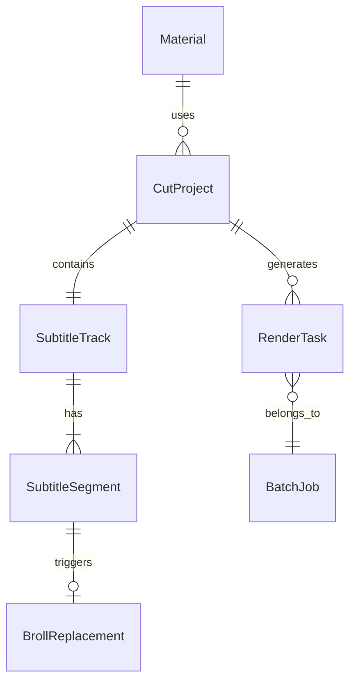
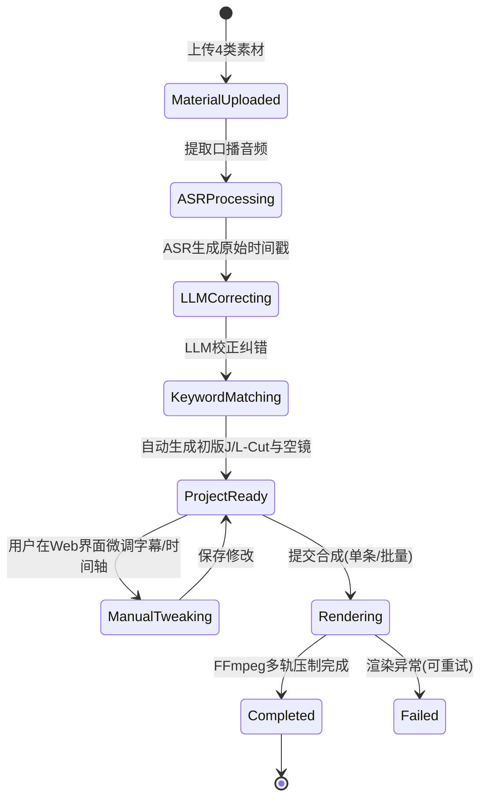

# 数据模型与实体规约 (Data Model Specification)

**Feature**: `001-driving-school-video-cut`  
**Date**: 2026-09-15  
**Status**: Ready  

---

## 1. 核心实体模型 (Core Entities)

### 1.1 素材实体 (Material)
代表用户上传的原始音视频素材。

| 字段 | 类型 | 必填 | 描述 |
| :--- | :--- | :--- | :--- |
| `id` | string (UUID) | 是 | 唯一标识符 |
| `category` | enum | 是 | 枚举值：`talking_head` (口播), `venue` (场地), `medical` (体检), `lesson` (教学学车) |
| `filename` | string | 是 | 原始文件名 |
| `filepath` | string | 是 | 磁盘相对存储路径，如 `storage/materials/venue/v1.mp4` |
| `duration` | float | 是 | 视频时长（秒，保留3位小数） |
| `width` | int | 是 | 视频宽度（像素） |
| `height` | int | 是 | 视频高度（像素） |
| `fps` | float | 是 | 视频帧率 |
| `created_at` | string (ISO8601) | 是 | 上传时间戳 |

---

### 1.2 字幕片段实体 (SubtitleSegment)
代表口播语音识别出的单句带时间戳文本。

| 字段 | 类型 | 必填 | 描述 |
| :--- | :--- | :--- | :--- |
| `id` | string (UUID) | 是 | 唯一标识符 |
| `start_time` | float | 是 | 起始时间（秒，如 `4.250`） |
| `end_time` | float | 是 | 结束时间（秒，如 `8.500`） |
| `raw_text` | string | 是 | ASR 原始识别文字 |
| `corrected_text` | string | 是 | LLM 上下文纠错后的文字 |
| `matched_category` | enum? | 否 | 命中的空镜类别：`venue`, `medical`, `lesson`，未命中为 null |
| `matched_keywords` | list[str] | 否 | 触发命中的关键词列表，如 `["训练场", "五万平"]` |
| `is_manual_edited` | boolean | 是 | 标记是否被人工手动修改过 |

---

### 1.3 空镜替换规则实体 (BrollReplacement)
代表在指定时间区间内将视频画面替换为 B-roll 的动作。

| 字段 | 类型 | 必填 | 描述 |
| :--- | :--- | :--- | :--- |
| `id` | string (UUID) | 是 | 唯一标识符 |
| `start_time` | float | 是 | 画面替换开始时间 |
| `end_time` | float | 是 | 画面替换结束时间 |
| `material_id` | string (UUID) | 是 | 关联的空镜素材 ID |
| `material_category` | enum | 是 | `venue` / `medical` / `lesson` |
| `playback_mode` | enum | 是 | `fit` (自然截取), `loop` (若时长不足则循环), `slow` (平滑降速) |

---

### 1.4 剪辑工程实体 (CutProject)
代表单个视频剪辑任务的完整工作态。

| 字段 | 类型 | 必填 | 描述 |
| :--- | :--- | :--- | :--- |
| `id` | string (UUID) | 是 | 唯一标识符 |
| `title` | string | 是 | 工程标题（默认取口播文件名） |
| `talking_head_id` | string (UUID) | 是 | 主口播素材 ID |
| `aspect_ratio` | enum | 是 | `9:16` (默认竖屏) 或 `16:9` (横屏) |
| `subtitles` | list[SubtitleSegment] | 是 | 字幕与时间戳序列 |
| `broll_replacements` | list[BrollReplacement]| 是 | 空镜替换列表 |
| `status` | enum | 是 | `draft` (就绪), `processing` (渲染中), `completed` (已完成), `failed` (失败) |
| `output_video_path` | string? | 否 | 最终合成视频路径 |
| `updated_at` | string (ISO8601) | 是 | 最后修改时间 |

---

### 1.5 批量生产任务 (BatchJob)
代表用户提交的批量混剪任务集。

| 字段 | 类型 | 必填 | 描述 |
| :--- | :--- | :--- | :--- |
| `id` | string (UUID) | 是 | 批量作业 ID |
| `total_count` | int | 是 | 计划生成视频总数 |
| `completed_count` | int | 是 | 已完成视频数 |
| `concurrency` | int | 是 | 当前动态分配的并发数 |
| `status` | enum | 是 | `queued`, `running`, `paused`, `finished` |
| `tasks` | list[RenderTask] | 是 | 子渲染任务列表 |
| `resource_snapshot`| object | 是 | 启动时的硬件资源快照（CPU/内存/GPU可用性） |

---

## 2. 状态机流转 (State Transitions)

