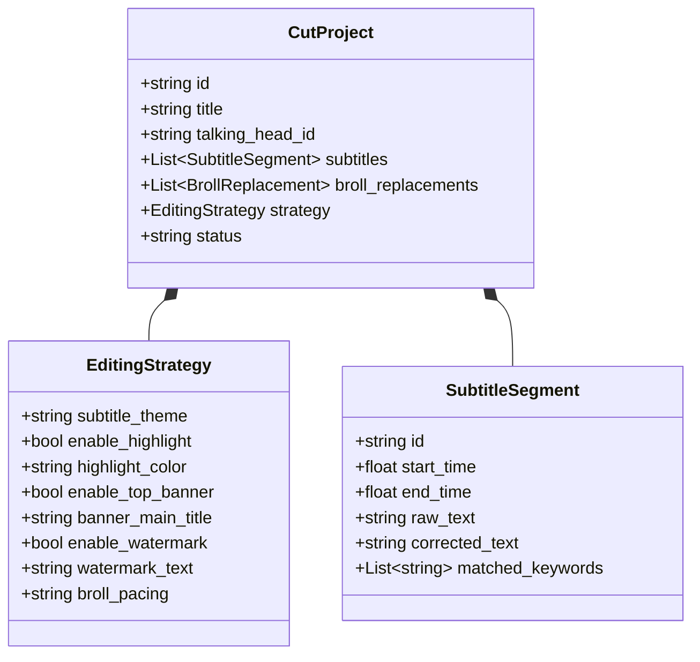

# Data Model: 剪辑策略与字幕呈现数据模型 (003-subtitle-strategy-preview)

## 1. 实体定义

### 1.1 EditingStrategy (工程剪辑策略配置对象)
用于持久化保存在 `CutProject` 中，控制播放器渲染与后端 FFmpeg 导出。

```typescript
export interface EditingStrategy {
  // 1. 字幕样式策略
  subtitle_theme: 'viral_gold' | 'tech_emerald' | 'marker_pen' | 'minimal_white';
  font_size: 'small' | 'medium' | 'large'; // 对应 12px, 14px, 16px (移动端按比例缩放)
  
  // 2. 关键词高亮策略
  enable_highlight: boolean;
  highlight_color: string; // 例如 "#FACC15" (金黄), "#10B981" (翠绿), "#F43F5E" (亮红)
  highlight_scale: boolean; // 是否轻微放大 1.1x
  custom_highlight_words: string[]; // 用户手动追加的高亮词

  // 3. 顶部 Title 挂顶横幅策略
  enable_top_banner: boolean;
  banner_main_title: string; // 主标题，例如 "新手学车必看 · 科目二"
  banner_sub_title?: string; // 副标题/标语，例如 "金牌教练教学"
  banner_style: 'capsule' | 'full_width';

  // 4. 品牌水印策略
  enable_watermark: boolean;
  watermark_text: string; // 例如 "@顺达驾校官方"
  watermark_position: 'top_right' | 'top_left' | 'bottom_right';
  watermark_opacity: number; // 0.2 ~ 0.8，默认 0.4

  // 5. 空镜穿插节奏策略
  broll_pacing: 'fast' | 'standard' | 'talking_only'; // 2s / 3.5s / 0
}
```

### 1.2 CutProject 扩展
在 `backend/app/models/entities.py` 的 `CutProject` 增加 `strategy: EditingStrategy` 字段。

```python
class EditingStrategy(BaseModel):
    subtitle_theme: str = "viral_gold"
    font_size: str = "medium"
    enable_highlight: bool = True
    highlight_color: str = "#FACC15"
    highlight_scale: bool = True
    custom_highlight_words: List[str] = []
    
    enable_top_banner: bool = True
    banner_main_title: str = "科目二一把过秘籍"
    banner_sub_title: Optional[str] = "教练手把手教学"
    banner_style: str = "capsule"
    
    enable_watermark: bool = True
    watermark_text: str = "XX驾校官方教学"
    watermark_position: str = "top_right"
    watermark_opacity: float = 0.4
    
    broll_pacing: str = "standard"
```

---

## 2. 关系与转换关系

