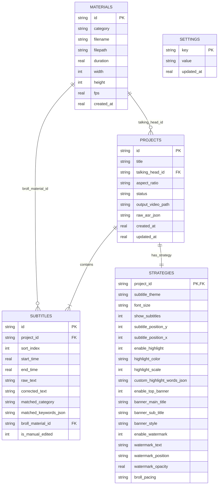

# 数据模型规范 (Data Model): SQLite 关系型存储设计

- **功能编号**: 004
- **特性名称**: `004-electron-sqlite-cross-build`
- **存储文件**: `videocut.db` (SQLite 3.x with WAL mode)

---

## 1. 实体关系模型 (ER Diagram)



---

## 2. 表结构详细定义与 DDL

### 2.1 `materials` (素材表)
```sql
CREATE TABLE IF NOT EXISTS materials (
    id TEXT PRIMARY KEY,
    category TEXT NOT NULL CHECK(category IN ('talking_head', 'venue', 'medical', 'lesson')),
    filename TEXT NOT NULL,
    filepath TEXT NOT NULL,
    duration REAL NOT NULL DEFAULT 0.0,
    width INTEGER NOT NULL DEFAULT 1080,
    height INTEGER NOT NULL DEFAULT 1920,
    fps REAL NOT NULL DEFAULT 30.0,
    created_at REAL NOT NULL
);
CREATE INDEX IF NOT EXISTS idx_materials_category ON materials(category);
```

### 2.2 `projects` (剪辑工程表)
```sql
CREATE TABLE IF NOT EXISTS projects (
    id TEXT PRIMARY KEY,
    title TEXT NOT NULL,
    talking_head_id TEXT NOT NULL,
    aspect_ratio TEXT NOT NULL DEFAULT '9:16',
    status TEXT NOT NULL DEFAULT 'draft' CHECK(status IN ('draft', 'processing', 'completed', 'failed')),
    output_video_path TEXT,
    raw_asr_json TEXT,
    created_at REAL NOT NULL,
    updated_at REAL NOT NULL,
    FOREIGN KEY(talking_head_id) REFERENCES materials(id) ON DELETE CASCADE
);
CREATE INDEX IF NOT EXISTS idx_projects_th ON projects(talking_head_id);
```

### 2.3 `subtitles` (字幕分句轨道表)
```sql
CREATE TABLE IF NOT EXISTS subtitles (
    id TEXT PRIMARY KEY,
    project_id TEXT NOT NULL,
    sort_index INTEGER NOT NULL,
    start_time REAL NOT NULL,
    end_time REAL NOT NULL,
    raw_text TEXT NOT NULL,
    corrected_text TEXT NOT NULL,
    matched_category TEXT,
    matched_keywords_json TEXT DEFAULT '[]',
    broll_material_id TEXT,
    is_manual_edited INTEGER NOT NULL DEFAULT 0,
    FOREIGN KEY(project_id) REFERENCES projects(id) ON DELETE CASCADE
);
CREATE INDEX IF NOT EXISTS idx_subtitles_project ON subtitles(project_id, sort_index);
```

### 2.4 `strategies` (剪辑策略工坊参数表)
```sql
CREATE TABLE IF NOT EXISTS strategies (
    project_id TEXT PRIMARY KEY,
    subtitle_theme TEXT NOT NULL DEFAULT 'glow_gold',
    font_size TEXT NOT NULL DEFAULT 'medium',
    show_subtitles INTEGER NOT NULL DEFAULT 1,
    subtitle_position_y INTEGER NOT NULL DEFAULT 82,
    subtitle_position_x INTEGER NOT NULL DEFAULT 50,
    enable_highlight INTEGER NOT NULL DEFAULT 1,
    highlight_color TEXT NOT NULL DEFAULT '#FACC15',
    highlight_scale INTEGER NOT NULL DEFAULT 1,
    custom_highlight_words_json TEXT DEFAULT '[]',
    enable_top_banner INTEGER NOT NULL DEFAULT 1,
    banner_main_title TEXT NOT NULL DEFAULT '科目二一把过秘籍',
    banner_sub_title TEXT DEFAULT '教练手把手教学',
    banner_style TEXT NOT NULL DEFAULT 'capsule',
    enable_watermark INTEGER NOT NULL DEFAULT 1,
    watermark_text TEXT NOT NULL DEFAULT '@顺达驾校官方教学',
    watermark_position TEXT NOT NULL DEFAULT 'top_right',
    watermark_opacity REAL NOT NULL DEFAULT 0.45,
    broll_pacing TEXT NOT NULL DEFAULT 'standard',
    FOREIGN KEY(project_id) REFERENCES projects(id) ON DELETE CASCADE
);
```

### 2.5 `settings` (全局配置键值表)
```sql
CREATE TABLE IF NOT EXISTS settings (
    key TEXT PRIMARY KEY,
    value TEXT NOT NULL,
    updated_at REAL NOT NULL
);
```

---

## 3. 数据迁移与历史数据平滑升级机制

系统启动时执行 `sqlite_migrator.py`：
1. 检测是否存在旧版的 `storage/materials_meta.json`。若存在且表为空，循环批量插入至 `materials`。
2. 扫描 `storage/projects/*.json`。若存在旧工程，解构写入 `projects`、`subtitles` 与 `strategies` 表中。
3. 检测旧版的 `storage/settings.json`，导入至 `settings` 表中。
4. 迁移完成后将旧 JSON 重命名归档（如 `materials_meta.json.migrated`），保障历史操作记录与素材 100% 完整继承。
