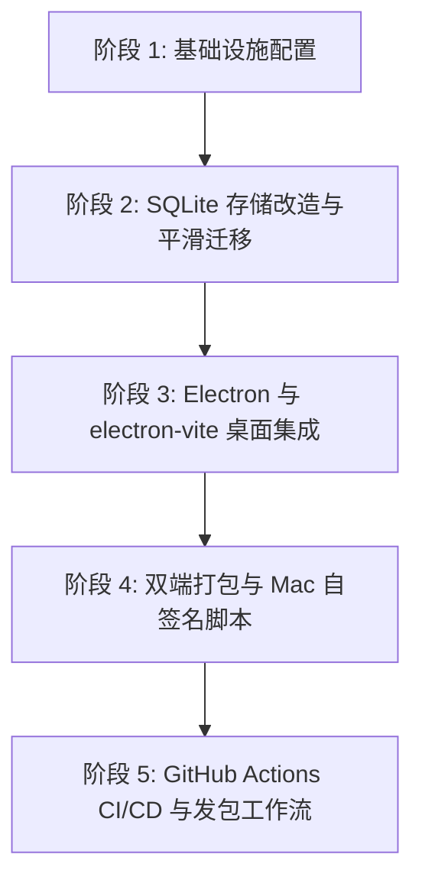

# 任务清单 (Tasks): 架构迁移至 Electron、SQLite 存储与 Windows/macOS 双端打包发布

**Input**: 设计文档位于 [`specs/004-electron-sqlite-cross-build/`](file:///d:/project/video_cut/specs/004-electron-sqlite-cross-build/)
**Prerequisites**: [plan.md](file:///d:/project/video_cut/specs/004-electron-sqlite-cross-build/plan.md), [spec.md](file:///d:/project/video_cut/specs/004-electron-sqlite-cross-build/spec.md), [research.md](file:///d:/project/video_cut/specs/004-electron-sqlite-cross-build/research.md), [data-model.md](file:///d:/project/video_cut/specs/004-electron-sqlite-cross-build/data-model.md), [contracts/](file:///d:/project/video_cut/specs/004-electron-sqlite-cross-build/contracts/)

---

## 任务格式规范: `[ID] [P?] [Story] 任务描述`
- **[P]**: 支持并行开发（不同文件、无阻塞依赖）
- **[US1]**: 故事 1 - SQLite 关系型存储层升级与历史数据平滑迁移 (Priority: P1 🎯 MVP)
- **[US2]**: 故事 2 - Electron 原生桌面端、electron-vite 与静默后台守护 (Priority: P1 🎯 MVP)
- **[US3]**: 故事 3 - Windows 与 macOS 本地双端打包与免证书自签名交付 (Priority: P2)
- **[US4]**: 故事 4 - GitHub Actions 跨平台 CI/CD 与 GitHub CLI 自动化发包 (Priority: P3)

---

## 阶段 1: 基础设施与准备工作 (Phase 1: Setup)

**目标**: 初始化桌面项目结构与 SQLite 存储目录结构

- [x] T001 确保项目根目录基础结构对齐，创建 `backend/app/db/`、`src/main/`、`src/preload/` 及 `resources/` 目录结构
- [x] T002 在 `backend/app/core/config.py` 中增加 SQLite 数据库文件路径定义 (`DB_PATH = STORAGE_DIR / "videocut.db"`)
- [x] T003 [P] 创建应用图标资源占位符 `resources/icon.png`、`resources/icon.ico` 与 `resources/icon.icns`

---

## 阶段 2: 核心基座 - SQLite 关系型存储与平滑迁移 (Phase 2: US1 - SQLite Persistence) 🎯 MVP

**目标**: 将分散的 JSON 元数据彻底升级至 SQLite（WAL 高性能并发模式），实现素材、工程、字幕轨道、策略工坊与设置的原子存取与历史资产零丢失迁移。

**独立测试标准**: 运行 `pytest tests/test_sqlite_storage.py -v` 验证数据库建表、WAL 模式开启、CRUD 以及旧 JSON 数据自动导入均 100% 通过。

### 自动化测试
- [x] T004 [P] [US1] 编写 SQLite 存储自动化测试套件 `tests/test_sqlite_storage.py`（覆盖建表、CRUD、级联删除与迁移断言）

### 具体实现任务
- [x] T005 [P] [US1] 编写 `backend/app/db/schema.sql`，定义 `materials`、`projects`、`subtitles`、`strategies`、`settings` 严格 DDL 与索引
- [x] T006 [US1] 编写 `backend/app/db/session.py`，实现 SQLite 线程安全连接池、外键约束开启 (`PRAGMA foreign_keys=ON;`) 与 WAL 模式初始化 (`PRAGMA journal_mode=WAL;`)
- [x] T007 [US1] 编写 `backend/app/db/repository.py`，实现素材元数据、剪辑工程、字幕切片、策略参数与配置项的数据访问接口 (Repository)
- [x] T008 [US1] 编写 `backend/app/db/migrator.py`，系统启动时自动检测并无缝将旧版 `materials_meta.json`、`projects/*.json` 和 `settings.json` 导入 SQLite
- [x] T009 [US1] 重构 `backend/app/native_engine/storage.py` 与 `project_storage.py` 对接 SQLite 仓库，保持上层 API 兼容
- [x] T010 [US1] 运行 `pytest tests/ -v` 确保现有全量 29 项测试及新增数据库测试全部绿灯通过

**检查点 1**: 数据库升级完成，历史工程与素材成功迁移至 `videocut.db`，读写性能提升且具备完整事务与级联支持。

---

## 阶段 3: Electron 原生桌面端与后台守护 (Phase 3: US2 - Electron & electron-vite) 🎯 MVP

**目标**: 采用 `electron-vite` 实现多进程桌面端构建，实现零终端黑框启动，主进程智能静默拉起与托管 Python 算力引擎。

**独立测试标准**: 运行 `pnpm dev` 桌面窗口自动居中优雅淡入展示，无终端控制台黑框弹出，前端可正常通信与操作。

### 具体实现任务
- [x] T011 [US2] 在根目录配置 `package.json`，集成 `electron`, `electron-vite`, `electron-builder` 依赖与启动脚本
- [x] T012 [P] [US2] 编写 `electron.vite.config.ts`，统一配置 `main`, `preload`, `renderer`（复用现有 React 前端与 Tailwind 插件）
- [x] T013 [US2] 编写 `src/main/engine-manager.ts`，实现 Python 引擎健康探测、动态子进程拉起、优雅退出与防止僵尸进程常驻
- [x] T014 [US2] 编写 `src/main/ipc-handlers.ts`，注册原生系统文件选择对话框、窗口最小化/最大化/关闭及外部路径打开 IPC 处理器
- [ ] T015 [US2] 编写 `src/main/index.ts`，实现主窗口生命周期管理、优雅防白屏加载 (`ready-to-show`) 与托盘安全策略（虚勾撤回：当前无 Tray 与单实例锁，sidecar 化时补齐）
- [x] T016 [P] [US2] 编写 `src/preload/index.ts` 与 `src/preload/index.d.ts`，通过 `contextBridge` 安全暴露 `window.electronAPI`
- [x] T017 [US2] 改造前端页面，在素材库与工作台适配 Electron 原生文件选择对话框与窗口控制

**检查点 2**: 双击或执行 `pnpm dev` 即可拉起完整桌面应用，Python 后台隐式守护运行，API 通信无缝衔接。

---

## 阶段 4: 双端打包与 macOS 免证书自签名交付 (Phase 4: US3 - Cross Packaging & macOS Self-Sign)

**目标**: 在 Windows 宿主机上本地构建 Windows 安装包 (`.exe`) 与 macOS 应用包 (`.zip`)，交付免苹果证书的 Quarantine 隔离解除方案。

**独立测试标准**: 在 Windows 终端运行 `pnpm build:win` 与 `pnpm build:mac-zip` 成功产出可执行安装程序与 Mac 压缩包。

### 具体实现任务
- [x] T018 [US3] 编写 `electron-builder.yml`，定义 Windows NSIS 安装包配置（桌面图标、开始菜单、自定义安装路径、静默升级）
- [x] T019 [US3] 在 `electron-builder.yml` 中配置 macOS 目标（`target: [dmg, zip]`、`identity: null` Ad-Hoc 自签名、禁用 hardenedRuntime）
- [x] T020 [P] [US3] 编写 `resources/一键解除Mac拦截.command` 脚本，自动化执行 `xattr -r -d com.apple.quarantine` 永久清除苹果 Gatekeeper 拦截
- [ ] T021 [US3] 在 `package.json` 中配置 `build:win` 与 `build:mac-zip` 构建命令，并在 Windows 下执行实测验证打包产物（虚勾撤回：当前产物未打包 Python 引擎，安装后无法拉起后端，待 sidecar 化后回归实测）

**检查点 3**: 产物目录 `dist/` 成功输出 `VideoCut-Setup-1.0.0.exe` 与 `VideoCut-1.0.0-mac.zip`，Mac 拦截解除脚本就绪。

---

## 阶段 5: GitHub Actions 跨平台 CI/CD 与一键发包 (Phase 5: US4 - GitHub Actions & Release)

**目标**: 利用本地已有的 `gh.exe` (GitHub CLI) 与 GitHub Actions 双矩阵，自动化构建原生产物并一键发布至 GitHub Releases。

**独立测试标准**: 推送版本 Tag 或触发流水线，GitHub 云端矩阵自动构建并生成 Release 挂载安装包。

### 具体实现任务
- [x] T022 [US4] 编写 `.github/workflows/release.yml`，配置 `windows-latest` 与 `macos-latest` 双矩阵编译环境
- [x] T023 [US4] 配置 GitHub Actions 中的产物挂载步骤（将 `.exe`、`.dmg`、`.zip` 自动发布至对应 Tag 的 GitHub Releases）
- [x] T024 [P] [US4] 编写 `scripts/publish-release.ps1`，封装基于本地 `gh.exe` 的极速发包指令，提供清晰的登录与发布指引
- [x] T025 [US4] 更新 `README.md` 与交付文档，标注 Windows/macOS 双端下载、安装指南与 Mac 免证书解除指引

---

## 阶段 6: 词库驱动纠偏链路与架构收敛 (Phase 6: 2026-09-17 代码审查补录)

**目标**: 消除多真相源与契约冲突：词库 glossary.json 唯一化、Harness 契约统一、SQLite 单一权威存储、sidecar 引擎打包。

### 已完成
- [x] T026 [P] 修复 `config.load_glossary` 缺失 `import json` 导致词库永不生效的致命 bug；mtime 缓存实现"编辑即生效"
- [x] T027 [P] 词库驱动全链路：embedded 确定性替换、LLM 提示词（`harness_bridge/prompting.py`，codex/zcode 共用）、ASR `initial_prompt` 热词、关键词高亮均实时读取 `storage/glossary.json`
- [x] T028 [P] `scripts/apply_glossary.py` 存量数据批量纠偏（SQLite+JSON 同步、试运行、自动备份、后端运行互斥）
- [x] T029 [P] Harness 契约统一：`base.py` 注解修正为 `HarnessCorrectionResponse`，zcode 桥接器接入共享提示词与词库兜底（修复激活即崩）
- [x] T030 [P] 铁律合规：ffmpeg 缺失/失败严禁复制原文件假装成功（抛真实异常，工程状态落库 FAILED）；词库缺失时空兜底 + 显式告警
- [x] T033 [P] LLM 调用分层：新增 `api` 直连引擎（OpenAI 兼容，共享 `llm_client.py` 传输层，设置页可配 model/apikey/baseurl/协议）承接字幕纠偏等固定格式任务；codex 直连 HTTP 逻辑并入共享层（不再吞异常）；开放式指令/聊天固定路由 Tier B（codex>zcode>embedded），chat 上下文瘦身为摘要
- [x] T034 [P] embedded 引擎瘦身：仅保留词库确定性纠偏（Tier A 离线兜底）；删除假装会开放式指令/聊天的 Stub 与预置话术（改为显式报错）；删除全项目零消费方的 generate_batch_variations 死链（base 契约改为可选能力默认报错）；Ping 改为流式 TTFT 首 Token 延迟测量；/settings/list-models 兼容 OpenAI 与 codex 代理两种 /models 结构
- [x] T035 [P] 引擎配置隔离：codex 提供方绑定 `codex_provider()`（只读本地 toml，与设置页 API 配置隔离），zcode 走本地 CLI 进程自身登录态；设置页配置区随引擎切换显示（api=直连配置，codex/zcode=本地配置说明卡），GET /settings 下发 engine_config 各引擎摘要（token 不下发）
- [x] T036 [P] 批量三问题修复：① 纠偏超时根因（推理模型 11 句需 82s，非流式 45s 必超时）→ `chat_completion_stream_full` 流式完整收集 + 纠偏分块 ≤12 句 + 超时错误明确化；② 并发公式 2.0→1.5GB/槽、submit 支持指定并发（硬顶 8）；③ 批量页逐条明细 + 播放成片/打开成片目录按钮、详情接口回传成片绝对路径
- [x] T037 [P] 纠偏句集一致性守卫：模型返回 id 集合与输入不一致（自行合并/拆分/调序）时整块回退词库纠偏，杜绝纠偏文本错位腐蚀；提示词补充逐句对应禁令
- [ ] T038 存量碎片句的 AI 纠偏覆盖率：先在自然句（黄金切割前）层面做 AI 纠偏、再执行 14 字切割，使模型无需面对句中碎片（需重构 transcribe/analyze 管线顺序，待确认）
- [x] T039 [P] 分镜编排层 plan_stable_windows：近邻合并防频闪（gap<0.8s 合并）、单镜时长钳制 [2s, 6s]（太长截断/太短延展或丢弃）、总覆盖收敛到 [40%,70%] 目标 60%；analyze 与 redecide_scenes 双入口接入；分镜提示词改为转折处切入+约六成覆盖编排要求；实测 22.7s 视频 2 窗各 6s 覆盖 53%，分类跨 venue/lesson/experience

### 待办
- [ ] T031 存储单一真相源收敛：repository 补齐 6 字段 + broll 字段、schema/session DDL 单权威、停写 JSON 双写、迁移后归档 `storage/legacy/`
- [ ] T032 sidecar 引擎打包与产品化：PyInstaller 引擎 + 动态端口 + 托盘/单实例 + CI 打包集成，兑现 T015/T021

---

## 依赖关系与推荐执行顺序

### 并行执行推荐：
- `T004` (测试编写) 与 `T005` (SQL DDL) 可完全并行。
- `T012` (electron.vite.config.ts) 与 `T016` (preload 脚本) 可并行。
- `T020` (Mac 解除拦截脚本) 与 `T018` (electron-builder 配置) 可并行。
