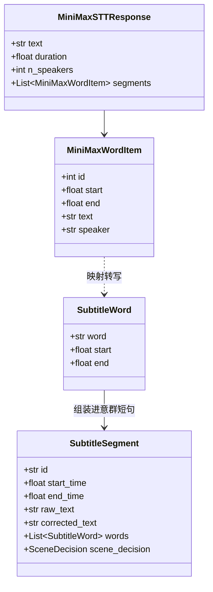
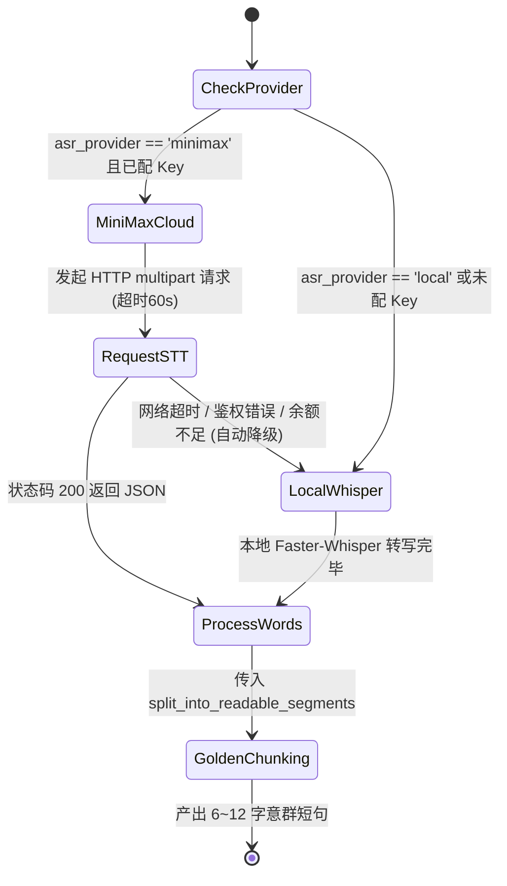

# Data Model: MiniMax 统一接管 ASR 与智能剪辑 (006-minimax-asr-llm)

## 1. 实体定义 (Entities)

### 1.1 ASRProvider (语音识别提供者枚举)
- **定义**: 标识底层转写所采用的引擎。
- **值域**:
  - `minimax`: MiniMax 云端极速大模型语音识别 (`asr-1.0`)
  - `local`: 本地 CPU/GPU Faster-Whisper 离线识别模型 (`base`)

### 1.2 MiniMaxWordItem (MiniMax 原始字级分词对象)
由 MiniMax STT 接口 `verbose_json` 的 `segments` 数组返回：
```json
{
  "id": 0,
  "start": 1.66,
  "end": 1.94,
  "speaker": "S1",
  "text": "从"
}
```
- `id` (int): 片段序号
- `start` (float): 该字声学开始时间（秒，精确至毫秒）
- `end` (float): 该字声学结束时间（秒，精确至毫秒）
- `text` (str): 识别出的单字或单词文本
- `speaker` (str): 说话人标签（默认 "S1"）

### 1.3 SubtitleWord (系统内统一定义的物理词单元)
存入 `SubtitleSegment.words` 数组中，供字幕跳字高亮及二次切分消费：
```json
{
  "word": "从",
  "start": 1.66,
  "end": 1.94
}
```

### 1.4 SystemSettings (系统设置持久化模型)
存储于 `storage/settings.json`：
```json
{
  "active_harness": "api",
  "llm_api_key": "sk-api-...",
  "llm_base_url": "https://api.minimaxi.com/v1",
  "llm_model": "MiniMax-Text-01",
  "llm_protocol": "openai",
  "asr_provider": "minimax"
}
```

---

## 2. 数据转换映射关系 (Data Mapping)



---

## 3. 状态与降级流转图 (State Transitions)

