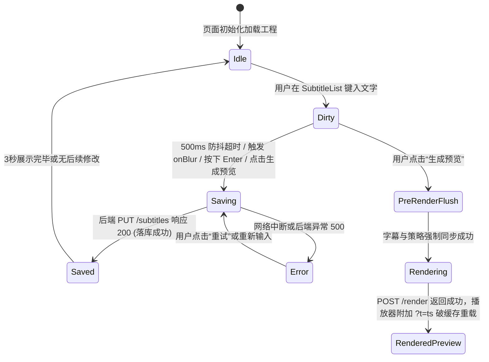

# Data Model: 字幕实时保存与成片预览所见即所得同步

**Feature**: `007-subtitle-sync-preview`  
**Date**: 2026-09-19  

## Entities & Interfaces

### 1. SubtitleSyncState (前端字幕同步与保存状态)

```typescript
export type SaveStatus = 'idle' | 'dirty' | 'saving' | 'saved' | 'error';

export interface SubtitleSyncMetadata {
  status: SaveStatus;
  lastSavedAt: number | null; // 时间戳 (ms)
  errorMessage: string | null;
  pendingCount: number;       // 当前处于脏态或未确认的条数
}
```

- **Validation Rules**:
  - `status === 'saving'`: 当有网络请求正在飞线提交时保持为 `saving`；
  - `status === 'saved'`: 提交成功后保持 3000ms 后平滑回退为 `idle`；
  - `status === 'error'`: 请求抛错时保持 `error`，必须阻止无感覆盖并向用户高亮重试按钮。

---

### 2. VideoViewportMetrics (实际视频画面物理视口矩形)

```typescript
export interface VideoViewportMetrics {
  containerWidth: number;   // 外部容器总宽（含黑边）
  containerHeight: number;  // 外部容器总高（含黑边）
  videoWidth: number;       // 实际视频渲染有效宽度（px）
  videoHeight: number;      // 实际视频渲染有效高度（px）
  offsetX: number;          // 视频居中水平偏移 (px)
  offsetY: number;          // 视频居中垂直偏移 (px)
  scaleFactor: number;      // 等比缩放因子 (videoHeight / 1920)
}
```

- **Invariants**:
  - `videoWidth <= containerWidth`
  - `videoHeight <= containerHeight`
  - `offsetX >= 0 && offsetY >= 0`
  - `scaleFactor > 0`
  - 竖屏 9:16 时：`videoWidth / videoHeight === 9 / 16`
  - 横屏 16:9 时：`videoWidth / videoHeight === 16 / 9`

---

### 3. SubtitleSegment (持久化字幕片段实体增强)

```python
class SubtitleSegment(BaseModel):
    id: str = Field(default_factory=lambda: str(uuid.uuid4()))
    start_time: float
    end_time: float
    raw_text: str
    corrected_text: str
    matched_category: Optional[MaterialCategory] = None
    matched_keywords: List[str] = Field(default_factory=list)
    highlight_words: List[HighlightWord] = Field(default_factory=list)
    words: List[SubtitleWord] = Field(default_factory=list)
    scene_decision: Optional[SceneDecision] = None
    broll_material_id: Optional[str] = None
    is_manual_edited: bool = False   # 标明该句文本或高亮是否曾由用户手工修改
```

- **Validation & Persistence Rules**:
  - `is_manual_edited`: 用户手动编辑文本或增删高亮词后置为 `True`；
  - 存库权威源：统一持久化于 SQLite `cut_projects.subtitles`（JSON 序列化存储），遵循单一事实源原则。

---

### 4. EditingStrategy (视觉与排版策略实体规范)

```python
class EditingStrategy(BaseModel):
    subtitle_theme: str = "glow_gold"
    font_size: str = "medium"
    subtitle_font_size: Optional[int] = 72    # 物理等比基准字号 (24~110)
    show_subtitles: bool = True
    subtitle_position_y: int = 82            # 垂直百分比 (0~100%)
    subtitle_position_x: int = 50            # 水平百分比 (0~100%)
    subtitle_width_percent: Optional[int] = 90 # 最大安全宽度百分比 (30~96%)
    enable_highlight: bool = True
    highlight_color: str = "#FACC15"
    highlight_scale: bool = True
    custom_highlight_words: List[str] = Field(default_factory=list)
    transition_style: str = "cut"
    
    # 顶部横幅与防搬运水印
    enable_top_banner: bool = False
    banner_main_title: str = "科目二一把过秘籍"
    banner_sub_title: Optional[str] = "教练手把手教学"
    banner_font_size: Optional[int] = 48
    banner_width_percent: Optional[int] = 90
    banner_position_x: int = 50
    banner_position_y: int = 6

    enable_watermark: bool = False
    watermark_text: str = "@顺达驾校官方教学"
    watermark_font_size: Optional[int] = 32
    watermark_position_x: int = 96
    watermark_position_y: int = 3
```

---

## State Transition Diagram


