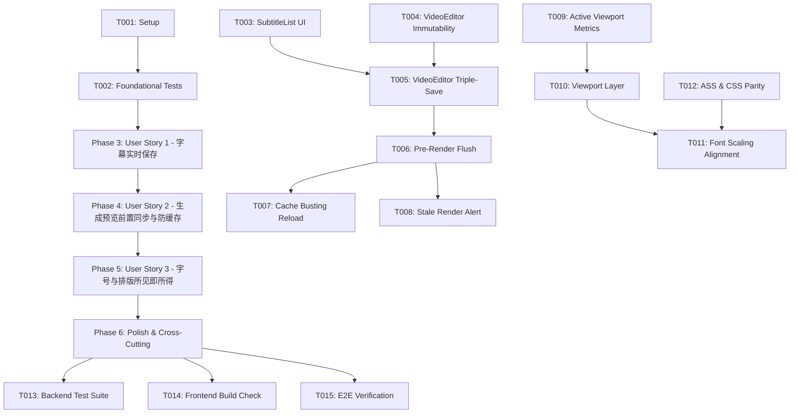

# Tasks: 字幕实时保存与成片预览所见即所得同步 (007-subtitle-sync-preview)

**Input**: Design documents from `specs/007-subtitle-sync-preview/` (`spec.md`, `plan.md`, `research.md`, `data-model.md`, `contracts/`, `quickstart.md`)  
**Prerequisites**: `plan.md` (required), `spec.md` (required for user stories), `data-model.md`, `contracts/api-endpoints.md`  

## Format: `[ID] [P?] [Story] Description with file path`
- **[P]**: 可并行执行的任务（不同文件、无未完成依赖）
- **[Story]**: 所属用户故事（[US1], [US2], [US3]），仅在故事开发阶段使用
- 描述中包含确切的文件路径

---

## Phase 1: Setup (Shared Infrastructure)

**Purpose**: 校验分支环境与基础支撑

- [X] T001 检查当前 git 分支并验证前后端工程运行环境 `AGENTS.md`

---

## Phase 2: Foundational (Blocking Prerequisites)

**Purpose**: 建立后端测试套件与接口契约基底，阻塞后续所有用户故事开发

**⚠️ CRITICAL**: 必须优先完成测试桩基础与接口落库校验

- [X] T002 编写字幕落库持久化与 ASS 样式字号映射契约测试在 `tests/test_subtitle_sync_and_styler.py`

**Checkpoint**: 测试基底已就绪，用户故事开发阶段可开启

---

## Phase 3: User Story 1 - 字幕即时持久化与编辑状态明确反馈 (Priority: P1) 🎯 MVP

**Goal**: 用户在字幕列表中修改任何文字或高亮词时，获得明确的状态反馈（“保存中...” → “✓ 已保存”），支持失焦即存与不可变更新，彻底消除数据丢失隐患。

**Independent Test**: 在字幕列表编辑某句文本，观察界面即时呈现保存中徽标；在输入框外部点击触发失焦或回车，确认状态迅速变为已保存；刷新页面验证修改文本被完整持久化。

### Implementation for User Story 1

- [X] T003 [P] [US1] 增强字幕列表组件界面，增加顶部持久化状态徽标（`SaveStatus`）与文本框 `onBlur`/Enter 即时提交回调在 `frontend/src/components/SubtitleList.tsx`
- [X] T004 [US1] 重构字幕文本修改逻辑为不可变对象拷贝更新（`map` + clone），并维护 `latestSubtitlesRef` 最新引用在 `frontend/src/pages/VideoEditor.tsx`
- [X] T005 [US1] 实现三重保存保障机制（500ms 防抖持久化、失焦即时 commit、失败手动重试）与保存状态机调度在 `frontend/src/pages/VideoEditor.tsx`

**Checkpoint**: 用户故事 1 已完成，字幕编辑具备实时保存状态反馈与失焦无延迟持久化。

---

## Phase 4: User Story 2 - 生成预览前强制刷新最新字幕与样式并破除成片缓存 (Priority: P1)

**Goal**: 点击“生成预览/渲染合成”前强制取消所有未完成防抖，阻塞等待最新字幕与策略写入 SQLite 后再触发复合渲染；渲染完成后以纳秒级时间戳破除播放器视频缓存，确保画面文字 100% 同步。

**Independent Test**: 编辑字幕后无需等待防抖直接点击“生成预览”，确认网络请求先完成字幕与策略落库再启动渲染；渲染完毕后播放器即时刷新且所呈现的画面字幕正是最新修改的内容。

### Implementation for User Story 2

- [X] T006 [US2] 在渲染主逻辑前置实现 `flushPendingSubtitles` 守卫，清除挂起定时器并链式同步最新字幕与策略在 `frontend/src/pages/VideoEditor.tsx`
- [X] T007 [US2] 实现渲染成片唯一时间戳 URL（`?t=${Date.now()}`）并在视频地址变化时调用 `videoRef.current.load()` 强制破除浏览器缓存在 `frontend/src/components/VideoPlayer.tsx`
- [X] T008 [US2] 增加已压制成片模式下的修改感知横幅（“当前播放上一版成片，需重新生成预览”）与一键切回实时编辑在 `frontend/src/pages/VideoEditor.tsx`

**Checkpoint**: 用户故事 2 已完成，生成预览与编辑内容实现强一致同步，消灭视频缓存停滞。

---

## Phase 5: User Story 3 - 交互编辑器与导出成片字号及排版像素级所见即所得 (WYSIWYG) 对齐 (Priority: P2)

**Goal**: 测量播放器实际物理画面有效像素（排除外围黑边），建立内部等比视口容器，将虚拟 DOM 字幕字号严格对齐 `videoH / 1920 * baseFontSize`，彻底消除实时编辑与压制成片的字号和折行差异。

**Independent Test**: 调节不同档位字幕字号（56px / 72px / 86px），在实时预览模式与压制成片播放模式下比对相同画面中的字幕字号、边距与折行位置，字高视觉占比误差在 ±2% 以内。

### Implementation for User Story 3

- [X] T009 [P] [US3] 实现物理视频有效视口（`VideoViewportMetrics`）几何算法，根据容器宽高比与视频宽高比动态计算画面位置与实际尺寸在 `frontend/src/components/VideoPlayer.tsx`
- [X] T010 [US3] 构建实际视频画面专用等比视口层（Active Viewport Layer），将字幕、横幅、水印与拖拽边界限制在物理画面内部在 `frontend/src/components/VideoPlayer.tsx`
- [X] T011 [US3] 重写字幕字号、最大宽度与边距换算逻辑，严格依据 `videoH / 1920` 等比映射在 `frontend/src/components/VideoPlayer.tsx`
- [X] T012 [P] [US3] 对齐 ASS 样式模板与前端预览 CSS 字体（微软雅黑优先）及行高行距基准在 `backend/app/native_engine/subtitle_styler.py`

**Checkpoint**: 用户故事 3 已完成，实现交互预览与成片压制像素级 1:1 所见即所得。

---

## Phase 6: Polish & Cross-Cutting Concerns

**Purpose**: 全链路自动化测试验证与类型构建检查

- [X] T013 [P] 运行后端单元与契约测试验证接口与样式契约通过在 `tests/test_subtitle_sync_and_styler.py`
- [X] T014 [P] 运行前端 TypeScript 编译与生产打包构建 `pnpm --prefix frontend build`
- [X] T015 执行全链路端到端手动验证流程并记录验证结果在 `specs/007-subtitle-sync-preview/quickstart.md`

---

## Dependencies & Story Execution Order

### Parallel Execution Opportunities
- **User Story 1**: T003 (`SubtitleList.tsx`) 与 T004 (`VideoEditor.tsx`) 可并行编写，随后在 T005 组合联调；
- **User Story 3**: T009 (`VideoPlayer.tsx` 几何测算) 与 T012 (`subtitle_styler.py` ASS 样式) 分属前后端，完全独立可并行；
- **Polish**: T013 (后端测试) 与 T014 (前端构建) 可完全并行执行。

### Implementation Strategy (MVP First)
1. **MVP（最小可行成果，Phase 1~3）**：首先实现字幕修改的不可变更新与失焦即存，并在界面展示保存状态，彻底解决用户“改了字幕好像没存下来”的第一大困惑；
2. **增量交付 1（Phase 4）**：解决生成预览前强制同步与时间戳破视频缓存，保证点击生成预览时 100% 呈现最新字幕；
3. **增量交付 2（Phase 5）**：重塑播放器有效视口与字号换算模型，达到实时编辑与压制成片 1:1 所见即所得；
4. **验证收尾（Phase 6）**：全套自动化单测与前端 CI 构建校验。
