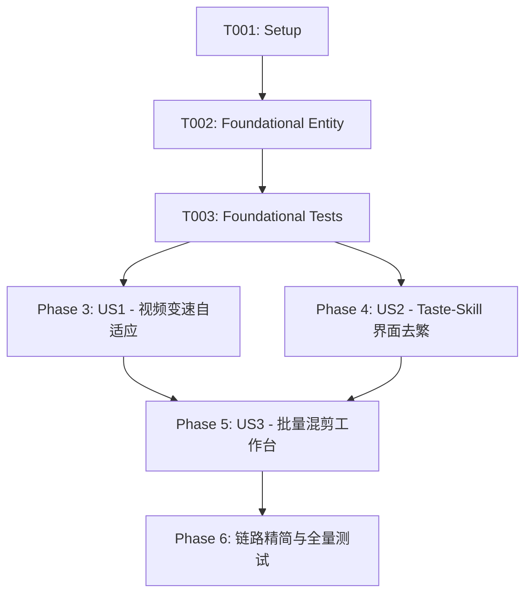

# Tasks: 视频编辑倍速、Taste UI 极简去繁与批量混剪工作台重构 (008-speed-clean-ui-batch)

**Input**: Design documents from `specs/008-speed-clean-ui-batch/` (`spec.md`, `plan.md`, `research.md`, `data-model.md`, `contracts/`, `quickstart.md`)  
**Prerequisites**: `plan.md` (required), `spec.md` (required for user stories), `data-model.md`, `contracts/api.md`  

## Format: `[ID] [P?] [Story] Description with file path`
- **[P]**: 可并行执行的任务（不同文件、无未完成依赖）
- **[Story]**: 所属用户故事（[US1], [US2], [US3]），仅在故事开发阶段使用
- 描述中包含确切的文件路径

---

## Phase 1: Setup (Shared Infrastructure)

**Purpose**: 校验分支环境与基础支撑

- [X] T001 检查当前 git 分支并验证前后端工程运行环境 `AGENTS.md`

---

## Phase 2: Foundational (Blocking Prerequisites)

**Purpose**: 建立后端数据模型与测试契约基底，阻塞后续所有用户故事开发

**⚠️ CRITICAL**: 必须优先完成实体校验与契约测试基底

- [X] T002 在 `backend/app/models/entities.py` 的 `EditingStrategy` 实体中增加 `video_speed: float = 1.0` 字段与校验
- [X] T003 编写视频编辑倍速与等比时间戳缩放测试在 `tests/test_composer.py`

**Checkpoint**: 基础模型与测试已就绪，用户故事开发阶段可开启

---

## Phase 3: User Story 1 - 视频剪辑变速与声画字幕等比自适应 (Priority: P1) 🎯 MVP

**Goal**: 用户在剪辑工作台调整口播语速（1.0x~1.25x），压制时通过 FFmpeg `setpts` 与 `atempo` 保持原调，并将所有字幕与空镜时间戳等比缩放，声画字幕 100% 严密对齐。

**Independent Test**: 选择 1.2x 倍速，成片时长缩短至原长约 83.3%，原声音调不变且字幕与口播真人发音精确对齐。

### Implementation for User Story 1

- [X] T004 [US1] 在 `backend/app/native_engine/ffmpeg_filter.py` 中实现多级 `atempo` 串联与 `setpts` 视频加速，并将 `broll_cuts` 起止时间等比缩放
- [X] T005 [US1] 在 `backend/app/api/editor.py` 中实现 `_prepare_render_subtitles` 等比缩放字幕与词级时间戳，并在 `/render` 接口透传 `video_speed`
- [X] T006 [P] [US1] 在 `frontend/src/components/StrategyStudio.tsx` 中增加「导出倍速与语速」控制卡片，支持 1.0x~1.25x 快捷档位与连续步长微调
- [X] T007 [P] [US1] 在 `frontend/src/services/api.ts` 中透传 `video_speed` 到 `EditingStrategy` 与 `renderProject` 接口

**Checkpoint**: 用户故事 1 已完成，视频加速与声画字幕等比缩放全链路畅通。

---

## Phase 4: User Story 2 - Taste-Skill 反油腻极简去繁与界面净化 (Priority: P1)

**Goal**: 遵循 `design-taste-frontend` 顶级审美标准，彻底删除页面上的冗余解释文案、自嗨式说明与花哨渐变，统一中性基底与单一主强调色，提升专业生产力沉浸感。

**Independent Test**: 审查页面 DOM 与文案，确认无任何多余系统说明段落、无重复 CTA、无冗余括号注释，操作一步直达。

### Implementation for User Story 2

- [X] T008 [P] [US2] 清理 `frontend/src/components/StrategyStudio.tsx` 中无意义的自嗨说明文字与多余主题，只保留「电影立体白」与字体质感对比
- [X] T009 [P] [US2] 重构 `frontend/src/pages/VideoEditor.tsx` 为极简 Segmented Switch（实时编辑 vs 成片预览），删除冗余横条与干扰文案
- [X] T010 [US2] 增加成片模式下的修改感知横幅（“字幕或策略已修改，当前画面仍为上一版成片”）与一键切换实时预览在 `frontend/src/pages/VideoEditor.tsx`
- [X] T011 [US2] 优化智能初剪与纠偏的交互反馈，仅在真正存在纠偏时展示明细卡片，杜绝无意义自嗨提示在 `frontend/src/pages/VideoEditor.tsx`

**Checkpoint**: 用户故事 2 已完成，界面清爽去繁，交互反馈克制专业。

---

## Phase 5: User Story 3 - 10年资深专家级批量混剪工作台 (Priority: P1)

**Goal**: 将批量混剪页面重构为生产级“内容工厂驾驶舱”，引入成片画廊（Gallery）与任务矩阵（Queue）双模态，极简收纳硬件监控指标，支持一键批量生产与高清成片直接播放导出。

**Independent Test**: 在批量混剪页面直接提交多个视频并设置倍速，任务以高密度进度条呈现，完成后直接在成片画廊点击播放高清 MP4 并能一键打开目录导出。

### Implementation for User Story 3

- [X] T012 [US3] 重构 `frontend/src/pages/BatchCut.tsx` 为驾驶舱架构，引入顶部 Command Bar 批处理控制台与画廊/队列双模态
- [X] T013 [P] [US3] 将 CPU/内存硬件监控收纳为极简状态芯片，消除 4 块臃肿大仪表板在 `frontend/src/pages/BatchCut.tsx`
- [X] T014 [US3] 实现成片画廊卡片流，支持 Hover 封面预览、弹窗极速播放成片 MP4 与一键打开文件位置在 `frontend/src/pages/BatchCut.tsx`
- [X] T015 [US3] 优化 `backend/app/api/batch.py` 批处理执行流水线，消除同一个视频被 FFmpeg 压制两次的浪费，单片直接压制最终成片与封面，耗时减半

---

## Phase 6: Polish, Pipeline Streamlining & Cross-Cutting Concerns

**Purpose**: 全链路计算冗余消除与自动化测试验证

- [X] T016 消除 `backend/app/api/editor.py` 中重复的口癖清洗与无业务消费的静态关键词分类匹配
- [X] T017 解耦单视频交互初剪与全量 FFmpeg 压制，单视频秒级进入实时编辑，并在顶部工具栏增加「⚡ 合成成片」按钮
- [X] T018 统一抽取通用的 `extract_cover_frame` 快速截帧工具函数在 `backend/app/api/editor.py`
- [X] T019 运行全量后端单元测试验证 139 项用例全部通过 (`uv run pytest`)
- [X] T020 运行前端 TypeScript 编译与生产打包构建验证零报错 (`pnpm run build`)

---

## Dependencies & Story Execution Order

