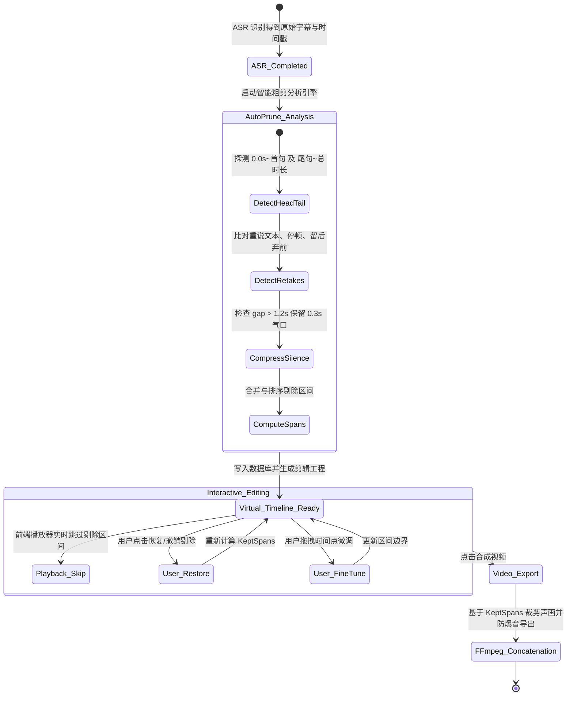

# Data Model: 智能剔除口播视频头尾动作与口误重说 (009-prune-retakes-silence)

## 1. 实体定义与字段关系

### 1.1 PruneSpan (时间轴剔除区间)
代表在原始素材时间轴上被判定或手动标记为“剔除/跳过”的时间区间。

| 字段名 | 类型 | 必填 | 默认值 | 说明 |
| :--- | :--- | :--- | :--- | :--- |
| `id` | `str` | 是 | `uuid4` | 剔除区间唯一标识 |
| `start_time` | `float` | 是 | - | 原始视频起始剔除时间点（秒，三位小数） |
| `end_time` | `float` | 是 | - | 原始视频结束剔除时间点（秒，三位小数） |
| `reason` | `str` | 是 | `head_idle` | 剔除原因枚举：`head_idle`(头部废动作), `tail_idle`(尾部关机动作), `retake_discard`(口误重说弃用), `mid_silence`(中段长空白压缩), `manual`(用户手动剔除) |
| `source_subtitle_id` | `Optional[str]` | 否 | `None` | 若关联具体口误字幕条目，记录对应的字幕 ID |
| `target_subtitle_id` | `Optional[str]` | 否 | `None` | 若为口误重说，记录替代保留的目标修正字幕 ID |
| `duration` | `float` | 是 | - | 剔除时长 = `end_time - start_time` |
| `is_active` | `bool` | 是 | `True` | 是否生效（若用户点击“恢复”，置为 `False`） |

---

### 1.2 SubtitleSegment (字幕条目扩展)
在已有的 `SubtitleSegment` 结构中扩展粗剪剔除相关元数据：

| 字段名 | 类型 | 必填 | 默认值 | 说明 |
| :--- | :--- | :--- | :--- | :--- |
| `is_pruned` | `bool` | 是 | `False` | 当前字幕条目是否被剔除（True 时播放器与成片跳过） |
| `prune_reason` | `Optional[str]` | 否 | `None` | 剔除原因（`head_idle` / `tail_idle` / `retake_discard` / `mid_silence` / `manual`） |
| `prune_span_id` | `Optional[str]` | 否 | `None` | 对应的底层 `PruneSpan` 标识 |

---

### 1.3 PruneStrategyConfig (粗剪与气口保留配置)
挂载在项目策略 `EditingStrategy` 或全局设置中，用于控制自动剪辑流水线中的粗剪参数。

| 字段名 | 类型 | 必填 | 默认值 | 说明 |
| :--- | :--- | :--- | :--- | :--- |
| `enable_auto_prune` | `bool` | 是 | `True` | 自动剪辑流水线中是否总控开启智能粗剪 |
| `enable_head_prune` | `bool` | 是 | `True` | 是否自动切除首句前的录制准备废动作 |
| `enable_tail_prune` | `bool` | 是 | `True` | 是否自动切除尾句后的关机废动作 |
| `enable_retake_prune` | `bool` | 是 | `True` | 是否自动识别并剔除口误重说前驱片段 |
| `enable_mid_silence_prune` | `bool` | 是 | `True` | 是否自动压缩中段单纯长停顿 (Jump Cut) |
| `head_padding_seconds` | `float` | 是 | `0.20` | 首句发音前的安全呼吸气口缓冲（秒） |
| `tail_padding_seconds` | `float` | 是 | `0.25` | 尾句发音后的自然收音气口缓冲（秒） |
| `mid_silence_threshold` | `float` | 是 | `1.20` | 触发中段长静音压缩的停顿阈值（秒，超过则切） |
| `mid_silence_breath_gap` | `float` | 是 | `0.30` | 中段静音压缩后保留的标准舒适呼吸间隙（秒） |
| `retake_pause_min` | `float` | 是 | `0.40` | 判定口误重说的最小停顿时间间隔（秒） |
| `retake_similarity_min` | `float` | 是 | `0.60` | 判定口误重说的字符序列相似度或包含率阈值 |

---

### 1.4 KeptSpan (合成保留时间区间，派生模型)
由原始视频时长减去所有活跃生效的 `PruneSpan` 自动归一化计算得出的有效发音/画面区间序列。

```python
class KeptSpan(BaseModel):
    start_time: float      # 原始视频起始点
    end_time: float        # 原始视频结束点
    duration: float        # 持续时长
    audio_fade: bool = True # 是否在头尾叠加微秒级防爆音 afade
```

---

## 2. 数据库持久化存储 (SQLite Schema Migration)

在 SQLite `storage/videocut.db` 中：
1. `projects` 表新增字段：
   - `prune_spans_json TEXT DEFAULT '[]'`: 存储当前工程全量剔除区间序列。
2. `subtitles` 表新增字段：
   - `is_pruned INTEGER NOT NULL DEFAULT 0`: 标记该字幕条目是否处于剔除状态。
   - `prune_reason TEXT DEFAULT NULL`: 记录剔除原因。

---

## 3. 状态流转与操作生命周期


