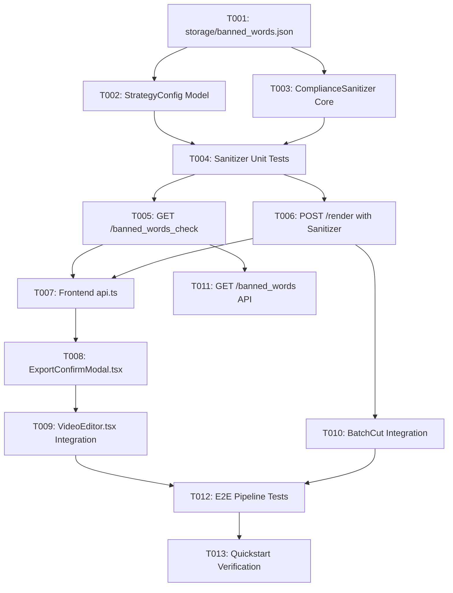

# Tasks: 抖音平台违禁词字幕合规清洗与多策略脱敏管线 (douyin-banned-words)

**Input**: Design documents from `specs/011-douyin-banned-words/`
**Prerequisites**: `plan.md`, `spec.md`, `research.md`, `data-model.md`, `contracts/editor-compliance.md`, `quickstart.md`

## Format: `[ID] [P?] [Story] Description`
- **[P]**: Can run in parallel (different files, no dependencies)
- **[Story]**: Which user story this task belongs to (e.g. US1, US2)
- All descriptions include explicit relative file paths

---

## Phase 1: Setup (Shared Infrastructure)

**Purpose**: 创建持久化词库与基础配置

- [x] T001 创建违禁词映射权威配置文件 `storage/banned_words.json`，持久化录入用户审定的 26 个形似字/拆字字典映射

---

## Phase 2: Foundational (Blocking Prerequisites)

**Purpose**: 核心脱敏清洗器与策略模型扩展（所有后续故事的基础）

**⚠️ 关键前置**: 本阶段任务未完成前，不可进入上层业务与界面开发

- [x] T002 [P] 在 `backend/app/models/project.py` 的 `StrategyConfig` 中扩展 `banned_words_enabled: bool = True` 与 `banned_words_mode: str = "glyph"` 字段
- [x] T003 [P] 创建核心清洗模块 `backend/app/core/compliance_sanitizer.py`，实现 `ComplianceSanitizer` 单例（基于 mtime 内存缓存热加载、长词优先贪婪排序、`sanitize_text`、`sanitize_subtitles` 和 `detect_banned_words`）
- [x] T004 编写单元测试 `tests/test_compliance_sanitizer.py`，验证 26 个敏感词及其衍生词（如“学弗/考试弗/模拟弗”）、长词优先匹配规则，以及高亮词对象（HighlightWord）`word` 字段的无损同步变换

**Checkpoint**: 基础清洗器与数据模型就绪，测试通过，可并行开启业务层接入

---

## Phase 3: User Story 1 - 剪辑工作台导出弹窗确认与敏感词透明预检 (Priority: P1) 🎯 MVP

**Goal**: 剪辑师在工作台点击导出时，系统调用预检 API 弹出确认弹窗，展示合规复选框与检测到的敏感词替换卡片，确认后导出脱敏成片

**Independent Test**: 打开包含“驾照”、“钱”、“费用”的视频工程，点击导出按钮唤起 `ExportConfirmModal`，展示替换明细；点击确认导出，成片字幕正确渲染为“贺照”、“銭”、“弗用”且高亮颜色完好

- [x] T005 [P] [US1] 在 `backend/app/api/editor.py` 中新增预检端点 `GET /projects/{project_id}/banned_words_check`，返回当前工程字幕命中的违禁词明细与替换预览
- [x] T006 [US1] 在 `backend/app/api/editor.py` 的 `render_project` 路由中，新增 `filter_banned_words: Optional[bool] = Query(None)` 参数，并在 `_prepare_render_subtitles` 与 `generate_ass_file` 渲染管线前接入 `ComplianceSanitizer.sanitize_subtitles`
- [x] T007 [P] [US1] 在 `frontend/src/services/api.ts` 中新增 `checkBannedWords` API 请求函数，并为 `renderProject` 函数补充 `filterBannedWords` 可选参数支持
- [x] T008 [P] [US1] 创建前端导出确认弹窗组件 `frontend/src/components/ExportConfirmModal.tsx`，展示导出概要、合规清洗复选框、违禁词命中标签卡片及确认/取消操作
- [x] T009 [US1] 在 `frontend/src/pages/VideoEditor.tsx` 中接入 `ExportConfirmModal`，点击导出时异步获取预检数据并弹出确认框，确认后触发带参渲染与成片预览切换

**Checkpoint**: User Story 1 具备独立端到端运行与交付能力 (MVP 完成)

---

## Phase 4: User Story 2 - 批处理混剪合规继承与全局词库查询 (Priority: P2)

**Goal**: 批量生产流水线默认开启合规脱敏单次压制，并支持前端/脚本查询当前生效的违禁词字典

**Independent Test**: 提交批量混剪任务，产物视频字幕自动完成违禁词脱敏，耗时维持 100% 单次压制水准；调用查询接口可返回完整 26 项字典

- [x] T010 [P] [US2] 在 `backend/app/api/batch.py` 批量剪辑合成链路中透传 `filter_banned_words` 参数，确保批量混剪默认以 100% 算力开销产出合规成片
- [x] T011 [US2] 在 `backend/app/api/editor.py` 中新增词库查询端点 `GET /banned_words`，返回当前内存加载的活跃映射字典供系统状态监控

---

## Phase 5: Polish & Cross-Cutting Concerns

**Purpose**: 全链路回归测试、边界防护与验证

- [x] T012 编写端到端回归测试 `tests/test_compliance_pipeline_e2e.py`，完整模拟“工程读取 -> 敏感词预检 -> 字幕清洗 -> ASS生成 -> FFmpeg压制”，断言 ASS 标签与成片完整性
- [x] T013 依照 `specs/011-douyin-banned-words/quickstart.md` 指南执行全流程实测验证，核查浏览器交互无控制台报错、画面排版无字间距异常

---

## Dependencies & Execution Order

