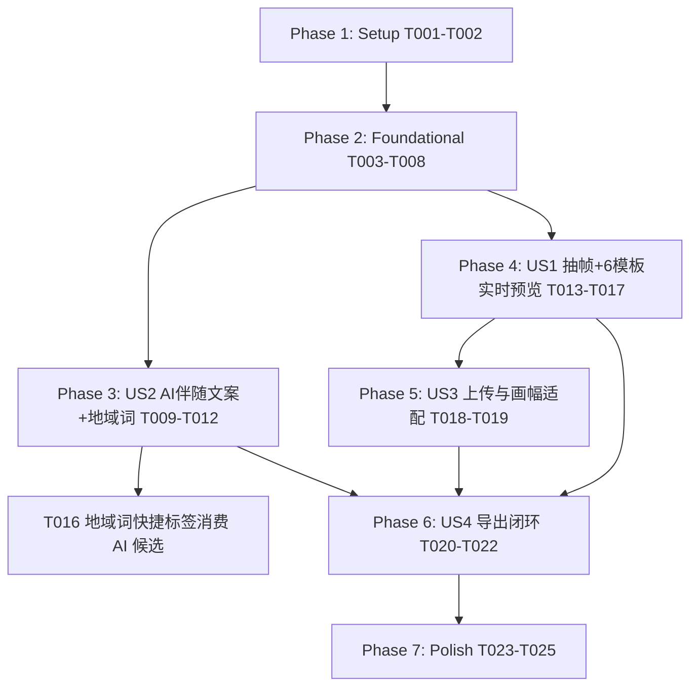

# Tasks: 视频封面设计与实战爆款模板升级 (012-video-cover-design)

**Input**: Design documents from `specs/012-video-cover-design/`
**Prerequisites**: [plan.md](./plan.md), [spec.md](./spec.md), [research.md](./research.md), [data-model.md](./data-model.md), [contracts/cover-api.md](./contracts/cover-api.md), [quickstart.md](./quickstart.md)

**Tests**: 已按 plan.md §5「验证与测试保障」与 quickstart.md 明确要求纳入测试任务（单元测试 + 接口测试 + 端到端），且遵守 AGENTS.md 测试边界：LLM 相关断言固定 embedded 词库引擎或 mock 响应，严禁真实联网调用。

**Organization**: 任务按用户故事分组，可独立实现与验证。注意：本分支已存在第一轮（4 模板版）实现，`backend/app/core/cover_generator.py`、`frontend/src/components/CoverPreviewSelector.tsx`、`ExportConfirmModal.tsx` 与三套测试文件均已存在——相关任务为**就地升级**，不是从零创建。

## Format: `- [ ] [TaskID] [P?] [Story?] Description with file path`

- **[P]**: Can run in parallel (different files, no dependencies)
- **[Story]**: Which user story this task belongs to (`[US1]`, `[US2]`, `[US3]`, `[US4]`)
- Every task includes explicit file paths

---

## Phase 1: Setup (Shared Infrastructure)

**Purpose**: 确认升级基线，锁定现状与 6 模板目标的差异

- [x] T001 验证 `.venv` 中 Pillow 可导入，`backend/app/core/cover_generator.py` 现有骨架（`COVER_TEMPLATES_CATALOG`、`adapt_image_aspect_ratio`、`render_cover_image`、`extract_candidate_frames`）加载正常，并记录与 6 大模板目标的差异清单（当前仅 gold_bold/color_badge/dual_contrast/clean_editorial 四分支，无 location_tag/调色盘/双层描边）
- [x] T002 [P] 运行升级前测试基线：`pytest tests/test_cover_generator.py tests/test_scene_decision_cover_titles.py tests/test_cover_pipeline_e2e.py -v`，确认旧版全绿后再动工

**Checkpoint**: 基线绿灯、差异清单明确，可安全开始升级

---

## Phase 2: Foundational (Blocking Prerequisites)

**Purpose**: 数据模型扩展 + 后端 Pillow 渲染核心（6 大模板、4 调色盘、3 大绘制算法）——所有用户故事的阻塞前置

**⚠️ CRITICAL**: 本阶段未完成前，任何用户故事不得开始

- [x] T003 扩展实体模型 `backend/app/models/entities.py` 的 `CoverDesignConfig`（:177）：新增 `location_tag`（地域词）与 `font_family`（`heavy_gothic`|`brush_kai`|`handwriting_tilt`|`editorial_serif`），`template_id` 扩展为 9 值 Literal（新增 `sticker_double_stroke`/`split_contrast_bar`/`rainbow_arc_header`/`bottom_fog_vignette`/`angled_impact_stamp`，保留 `clean_editorial` 与旧值 `gold_bold`/`color_badge`/`dual_contrast` 兼容），`color_theme` 收敛为 4 套调色盘 Literal（`authority_red`/`neon_cyber`/`hot_pink_gold`/`frost_burgundy`）；同步为 `SuggestedCoverTitle`（:189）新增 `location_tag` 字段（对齐 data-model.md §1）
- [x] T004 [P] 同步前端类型定义 `frontend/src/services/api.ts`：`CoverDesignConfig`（location_tag/font_family/template_id/color_theme）、`SuggestedCoverTitle`（location_tag/rationale）、`CoverTemplateItem`（category/badge/sample_preview/supported_themes）及新增 `CoverPalette`、`safe_zones` 响应结构（对齐 data-model.md 与 contracts/cover-api.md）
- [x] T005 在 `backend/app/core/cover_generator.py` 落地 4 套调色盘注册表（`authority_red` #B91C1C/#FFFFFF/#0F172A、`neon_cyber` #A5B4FC/#86EFAC/#000000、`hot_pink_gold` #F43F5E/#FACC15/#111827、`frost_burgundy` #991B1B/#FFFFFF/#FDE047，色值严格取自 research.md §4），并扩展 `get_font`/`_find_system_font` 支持 `font_family` 4 大字系候选链（Windows: msyhbd/simhei/楷体/宋体；macOS: PingFang/Kaiti SC/Songti SC），缺失时回退默认黑体，严禁因字体缺失中断渲染
- [x] T006 在 `backend/app/core/cover_generator.py` 实现三大核心绘制算法（research.md §5）：①双层描边 Painter's Algorithm 倒序渲染（外层白粗边 → 中层黑边 → 字芯原色）；②向上拱形弧排文字（圆心/半径/总弧度逐字极坐标定位+切线旋转）；③底部羽化白光线性渐变 Alpha 蒙版（自下而上 235→0 衰减合成纯白雾化层）
- [x] T007 在 `backend/app/core/cover_generator.py` 的 `render_cover_image` 实现 6 大模板渲染分支：`sticker_double_stroke`（顶部双层描边地域大字+底部胶囊标签）、`split_contrast_bar`（顶部红通栏白字+底部白通栏深红字三段式）、`rainbow_arc_header`（拱形包头字+斜角疑问手写）、`bottom_fog_vignette`（羽化白光+胸前立体字）、`angled_impact_stamp`（-10° 倾角贴纸+右侧双行金句+底部警示通栏）、`clean_editorial`（英文章节标+细横线+衬线副标）；`location_tag` 作为第一视觉锚点传入排版，旧 4 值分支保留兼容不删除
- [x] T008 重写扩充 `tests/test_cover_generator.py`：6 大模板 × 4 调色盘纯函数渲染断言（输出 1080x1920、RGBA 模式、双层描边像素采样含外白/中黑/字芯三层、拱形字坐标不越界、雾化蒙版顶部透明度趋零），以及 blur_padding/center_crop 对 16:9、1:1、3:4 输入的比例适配回归

**Checkpoint**: 6 模板后端出图全绿，调色盘与字系解析就绪，前端可开始消费

---

## Phase 3: User Story 2 - 剪辑阶段 AI 伴随式生成爆款封面文案与地域词 (Priority: P1)

**Goal**: 在既有分镜分析 LLM 请求中伴随提炼 2~3 组封面文案（含同城地域词 location_tag），零额外网络等待

**Independent Test**: 触发工程分析后，工程数据中 `suggested_cover_titles` 含 `location_tag`（如"武义学车"）与 6 大模板 style_hint；离线时有规则兜底不阻塞

### Implementation for User Story 2

- [x] T009 [US2] 升级 `backend/app/harness_bridge/prompting.py` 的 `build_scene_decision_prompt`（:86 附近）：指令新增「提取口播中的同城地域地名（如武义、金华金东、婺城、杭州、绍兴等）作为 location_tag 封面地域锚点」，`style_hint` 枚举更新为 6 大模板 ID，JSON 返回规范增加 `location_tag` 字段（沿用词库纠偏链路，严禁硬编码私有钱表）
- [x] T010 [US2] 升级 `backend/app/native_engine/scene_decision.py` 的 CueList 解析（:199-247）：透传 `location_tag` 与 `rationale` 字段，旧版无该字段的 LLM 响应兼容为空串，不破坏既有 highlights 解析
- [x] T011 [US2] 在 `backend/app/api/editor.py` 的 scene-decision 处理链路（:867 起）确认 `suggested_cover_titles`（含 location_tag）完整持久化到 `CutProject` 并随工程响应返回；离线/embedded 兜底时按视频标题与素材名规则提炼地域词候选，严禁返回预置假文案冒充 AI 结果
- [x] T012 [P] [US2] 扩充 `tests/test_scene_decision_cover_titles.py`：以 mock LLM 响应与 embedded 词库引擎断言 location_tag 提取、旧响应兼容、空响应防御（遵守 AGENTS.md 测试数据边界）

**Checkpoint**: 分析完成即得含地域词的封面文案候选，前端随时可消费

---

## Phase 4: User Story 1 - 视频智能抽帧与 6 大模板实时预览选择 (Priority: P1) 🎯 MVP

**Goal**: 前端 Canvas 与后端 Pillow 算法对齐，实现 6 模板卡片切换、地域词快捷标签、4 调色盘切换的毫秒级实时预览

**Independent Test**: 打开封面设计面板，候选帧与时间轴微调可用；切换 6 大模板与 4 调色盘时画布实时刷新；点击地域词快捷标签立即成为封面大字

### Implementation for User Story 1

- [x] T013 [US1] 升级 `backend/app/api/editor.py` 的 `GET /cover-templates`（:1088）与 `COVER_TEMPLATES_CATALOG`：按 contracts/cover-api.md 返回 6 大模板元数据（id/name/category/badge/sample_preview/description/supported_themes）+ 4 套调色盘 + `safe_zones`（douyin top0.05/bottom0.18/left0.05/right0.15；xiaohongshu 3:4 居中）
- [x] T014 [US1] 升级 `frontend/src/components/CoverPreviewSelector.tsx` 的 Canvas 渲染算法与后端严格对齐（research.md §5）：双层描边三层倒序绘制、向上拱形逐字旋转排布、上下通栏全宽色块、底部羽化雾化线性渐变、-10° 倾角贴纸旋转
- [x] T015 [US1] 在 `frontend/src/components/CoverPreviewSelector.tsx` 增加 6 模板卡片网格（展示 badge 与 sample_preview 标签）与 4 套调色盘快速切换；选中模板不支持的调色盘时自动回退 `supported_themes` 首选并给出轻提示
- [x] T016 [US1] 在 `frontend/src/components/CoverPreviewSelector.tsx` 增加「地域关键词」快捷标签栏：优先列出 AI 返回的 location_tag 候选（武义/金东/婺城/杭州/绍兴等），支持手动输入，点击即写入 `cover_config.location_tag` 并实时刷新画布
- [x] T017 [US1] 校验候选帧提取与文字联动链路：`backend/app/api/editor.py` 的 `POST /{project_id}/cover/candidates`（:1566）在极短视频（<3s）时回退 0.5s 帧不崩溃；前端主/副标题超长时 Canvas 折行规则与后端 `_wrap_text_to_lines` 表现一致

**Checkpoint**: 纯客户端毫秒级预览 6 模板 × 4 调色盘 × 地域大字，保存即由后端产出 1080x1920 成图

---

## Phase 5: User Story 3 - 自定义图片上传与画幅比例智能自适应 (Priority: P2)

**Goal**: 外部图片（16:9/1:1/3:4 等）高斯模糊填充或居中裁切自适应，平台安全区视框辅助

**Independent Test**: 上传 16:9 横图默认呈现模糊填充且主体完整居中；切换居中裁切铺满 9:16；开启安全区可见抖音/小红书参考线

### Implementation for User Story 2

- [x] T018 [US3] 核验并对齐 `backend/app/api/editor.py` 的 `POST /{project_id}/cover/upload` 与 `backend/app/core/cover_generator.py` 的 `adapt_image_aspect_ratio`：默认 `blur_padding`、`center_crop` 一键切换、超大图（>15MB 或 >4096x4096）前置拒绝并提示、响应结构对齐 contracts/cover-api.md
- [x] T019 [US3] 在 `frontend/src/components/CoverPreviewSelector.tsx` 中安全区视框改为消费 `/cover-templates` 返回的 `safe_zones` 定义（不再前端硬编码），绘制抖音底部标题/右侧操作栏避让框与小红书 3:4 居中双列虚线，随 `show_safe_zone` 开关显隐

**Checkpoint**: 任意比例上传图零拉伸变形，安全区预览与线上一致

---

## Phase 6: User Story 4 - 导出弹窗直观呈现与零转码开销闭环 (Priority: P1) 🎯 Core Flow

**Goal**: 导出确认弹窗一站式完成 6 模板/调色盘/地域词调整与 9:16 高清预览；成片单次合成同步输出 `cover.jpg`，可选 0.08s 首帧压入

**Independent Test**: 点击导出，弹窗内直接切换模板并预览；确认导出后产物目录含成片与 `cover.jpg`，增量耗时 <1s，无二次全片重编码

### Implementation for User Story 4

- [x] T020 [US4] 升级 `frontend/src/components/ExportConfirmModal.tsx`：导出弹窗内直呈 6 模板选择器 + 4 调色盘 + 地域词快捷编辑 + 9:16 高清预览（复用 `CoverPreviewSelector`），并保留「将封面压入视频第 1 帧（0.08s）」开关写入 `EditingStrategy.embed_cover_as_first_frame`（对齐 plan.md Phase 3）
- [x] T021 [US4] 校验并加固 `backend/app/api/editor.py` 的 `POST /{project_id}/render`（:1343、:1489 起）：单次合成流水线就地渲染 1080x1920 `cover.jpg` 落盘至任务目录；`embed_cover_as_first_frame` 开启时经 filter_complex 将封面帧压入 0.08s，严禁触发整片二次解码重编码；封面渲染失败时如实报错，严禁静默用旧图或黑图冒充成功
- [x] T022 [P] [US4] 扩充 `tests/test_cover_pipeline_e2e.py`：断言 `/cover-templates` 返回 6 模板与 4 调色盘及 safe_zones；带 location_tag 的封面配置保存后 `cover.jpg` 正确落盘且尺寸 1080x1920；开启首帧嵌入后成片时长较原片增加约 0.08s

**Checkpoint**: 导出即所得，产物完整（成片 + cover.jpg），零冗余转码开销

---

## Phase 7: Polish & Cross-Cutting Concerns

**Purpose**: 视觉统一、边界加固与全量回归

- [x] T023 视觉统一打磨：`frontend/src/components/CoverPreviewSelector.tsx` 与 `ExportConfirmModal.tsx` 遵循宪章 Clean Light Mode（高质感白/浅灰底、细腻阴影、舒适留白、克制主题色），统一模板卡片、调色盘圆片与加载态微交互
- [x] T024 [P] 边界加固：主标题 >20 字时前端 Canvas 与后端 `render_cover_image` 同步采用缩字号/语义折行防溢出（`backend/app/core/cover_generator.py` 的 `_wrap_text_to_lines`）；上传超大图前端客户端轻压缩为标准 JPEG/PNG 后再传
- [x] T025 运行 quickstart.md 全量验证：`pytest tests/test_cover_generator.py tests/test_scene_decision_cover_titles.py tests/test_cover_pipeline_e2e.py -v` 三套件全绿 + 前端 `frontend/` 构建通过（pnpm build），确认 6 模板 × 4 调色盘 × 地域大字端到端闭环

---

## Phase 8: R3 迭代 — 分区文本样式编辑与 AI 分区推荐 (2026-09-21，源自 plan.md §6 用户实测反馈)

**Purpose**: 每个文字区（location/main/sub）均可编辑文本、点击 AI 分区候选 chips、覆盖文字色/描边色/字号/位置；双端同规 + 渲染端 clamp

- [x] T026 扩展 `backend/app/models/entities.py`：新增 `CoverTextZoneStyle`（text_color/stroke_color 颜色格式校验、scale clamp [0.6,1.4]、offset_y clamp [-0.12,0.12]）与 `CoverDesignConfig.zone_styles`（Literal 键 location|main|sub，非法键/色 422，越界数值 clamp 后持久化）
- [x] T027 `backend/app/core/cover_generator.py` 六大模板接入分区覆盖（渲染取色三级优先级：分区覆盖→模板默认→调色盘）：`_resolve_zone_styles`/`_zone_scaled`/`_clamp_element_y`/`_clamp_y_in_band` 助手；split 主文案+副标整块布局钳入白通栏（防行间互压与同色融合）；fog 补 main 钩子行、editorial 补 location 衬线行（保证三区分区皆有元素）；无描边元素显式描边色补绘描边层；旧 4 模板保持兼容
- [x] T028 `backend/app/api/editor.py` `POST /{project_id}/cover` 契约扩展：`CoverRequest.zone_styles`（Literal 键 + 实体校验，非法输入 422）；合成与落盘携带 zone_styles 并回显 cover_config
- [x] T029 [P] `frontend/src/services/api.ts` 类型同步：`CoverZoneKey`/`CoverTextZoneStyle`/`zone_styles`
- [x] T030 `frontend/src/components/CoverPreviewSelector.tsx` 重排为「全局区（模板/调色盘/字系）+ 三分区编辑卡」：每区 = 文本输入 + AI 分区候选 chips（location_tag/main_title/sub_title 按区展开，AI 缺省回退学车特点库/副标兜底词）+ 文字色板 + 描边色板（调色盘 main/sub/accent + 纯白 + 纯黑）+ 字号/位置滑杆 + 恢复默认；Canvas 与后端同规则镜像（分区取色、clamp、色带整块钳制、描边补绘）
- [x] T031 新增 `tests/test_cover_zone_styles.py`：实体校验 422/clamp、`_resolve_zone_styles` 防御解析、六模板覆盖出图差异与极端偏移钳制、中性覆盖等价默认、POST /cover 契约（合法/非法/越界）、持久化无损往返
- [x] T032 样张视觉验收（visual-judge 四轮迭代）：修复 split 白底隐形（描边补绘）→ 行间互压（整块布局）→ fog main 缺失（补钩子行）→ editorial location 缺失与 main 描边无效（补地域行/补绘描边）；12/12 样张通过；全量回归 236 passed + pnpm build 通过

---

## Dependencies & Execution Order

### Story Dependencies

- **Foundational (Phase 2)**：实体/调色盘/算法/模板渲染是所有故事的地基，必须最先完成；
- **US2（AI 伴随文案+地域词）**：仅依赖 Foundational 的实体扩展，与 US1 可并行开发；其产出的 location_tag 候选被 US1 的 T016 快捷标签栏消费；
- **US1（抽帧+6 模板预览）**：依赖 Foundational 渲染核心与模板目录接口；
- **US3（上传与画幅）**：依赖 US1 的面板骨架与 Foundational 的 `adapt_image_aspect_ratio`；
- **US4（导出闭环）**：汇聚 US1/US2/US3，是最终交付主工作流，最后实施；
- **Polish (Phase 7)**：全链路闭环后统一打磨与回归。

### Within Each User Story

- 实体/类型先行，服务与渲染次之，接口与 UI 集成收尾
- 每个故事完成即独立可测（见各阶段 Independent Test）

### Parallel Opportunities

- **T002（基线测试）** 与 **T001** 可并行；
- **T003/T004**（后端实体 vs 前端类型）不同文件可并行；
- **Phase 3 (US2) 与 Phase 4 (US1)** 在 Foundational 完成后可双线并行（T009-T012 后端链路 vs T013-T017 接口+前端）；
- **T012 / T022** 独立测试文件可与对应实现任务并行编写（先失败后通过）；
- **T024** 边界加固与 T023 视觉打磨可并行。

---

## Implementation Strategy (MVP Scope)

- **MVP 核心交付路径**：Phase 1 + Phase 2 + Phase 4 (US1 抽帧与 6 模板实时预览) + Phase 6 (US4 导出闭环)
  - 达成效果：用户导入视频后点击导出，弹窗中即可挑选 6 大模板、切换 4 套调色盘、编辑地域大字并实时预览，导出同步产出成片 + 1080x1920 `cover.jpg`，零额外转码开销
- **增量扩展**：
  - 加入 US2：AI 伴随提炼含地域词的爆款文案，一键套用零等待
  - 加入 US3：外部照片高斯模糊/居中裁切自适应与平台安全区视框
- **升级红线**（AGENTS.md）：真实素材链路失败必须抛出真实异常；生产代码严禁静默回退预置文案或伪造成功；LLM 相关测试固定 embedded/mock，禁止真实联网

## Notes

- [P] tasks = different files, no dependencies
- [Story] label maps task to specific user story for traceability
- 本特性为既有实现的升级：改动前先读目标文件现状，保持旧 4 模板（gold_bold/color_badge/dual_contrast）向后兼容，不破坏存量工程数据
- Verify tests fail before implementing（新增断言先红后绿）
- Commit after each task or logical group
- Stop at any checkpoint to validate story independently
