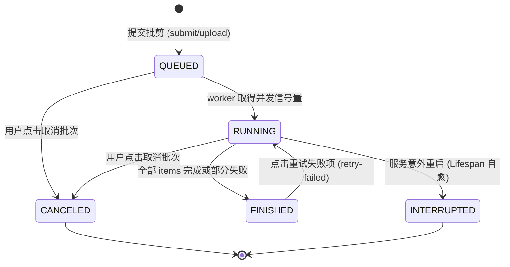

# Phase 1 数据模型与状态机契约 (013-system-resilience-ux)

## 1. 实体与状态枚举演进

### 1.1 批量作业状态枚举扩展 (`BatchJobStatus`)

在 [`app.models.entities`](file:///d:/project/video_cut/backend/app/models/entities.py) 中扩展批处理作业生命周期状态：

```python
class BatchJobStatus(str, Enum):
    QUEUED = "queued"              # 排队中
    RUNNING = "running"            # 正在多路并行剪辑中
    FINISHED = "finished"          # 全部条目处理完毕（可能含成功或失败）
    CANCELED = "canceled"          # 用户主动终止取消
    INTERRUPTED = "interrupted"    # 服务异常中断/断电重启被自愈标记
```

### 1.2 批量作业条目状态 (`BatchJobItem`)

```python
class BatchJobItem(BaseModel):
    material_id: str
    project_id: Optional[str] = None
    status: str = "queued"         # queued | running | completed | failed | canceled
    error: Optional[str] = None    # 真实失败详情（严禁静默吞掉）
    progress: int = 0              # 真实进度百分比：0 -> 5 -> 60 -> 100
```

### 1.3 初剪流水线阶段状态 (`PipelineProgress`)

与前端 UI 四阶段指示器对齐的细粒度阶段模型：

```python
class PipelineStage(str, Enum):
    IDLE = "idle"                          # 0%   空闲就绪
    AUDIO_EXTRACTING = "audio_extracting"  # 15%  提取高质量音频中
    ASR_TRANSCRIBING = "asr_transcribing"  # 45%  语音识别与自然句切分中
    LLM_CORRECTING = "llm_correcting"      # 70%  大模型专名词义校对中
    SCENE_DECIDING = "scene_deciding"      # 82%  双层黄金分镜智能编排中
    BROLL_MATCHING = "broll_matching"      # 90%  空镜对齐与高光词提取中
    VIDEO_COMPOSING = "video_composing"    # 95%  压制合成成片预览中 (若开启 auto_render)
    COMPLETED = "completed"                # 100% 流程完毕
    FAILED = "failed"                      # 0%   失败中断
```

---

## 2. 状态机流转图 (State Transitions)



---

## 3. 前端步骤指示器映射规范 (Step Tracker Spec)

前端 `VideoEditor.tsx` 将 `PipelineProgress.stage` 映射为清晰的视觉步骤：

| 步骤编号 | 视觉标签 | 包含的后端阶段 (`stage`) | 进度条基准 |
| :---: | :--- | :--- | :---: |
| **步骤 1** | 抽取音频 | `audio_extracting` | 15% |
| **步骤 2** | 语音转写 | `asr_transcribing` | 45% |
| **步骤 3** | AI专词纠偏 | `llm_correcting` | 70% |
| **步骤 4** | 分镜决策 | `scene_deciding`、`broll_matching` | 90% |
| **完成** | 初剪就绪 | `completed` | 100% |
