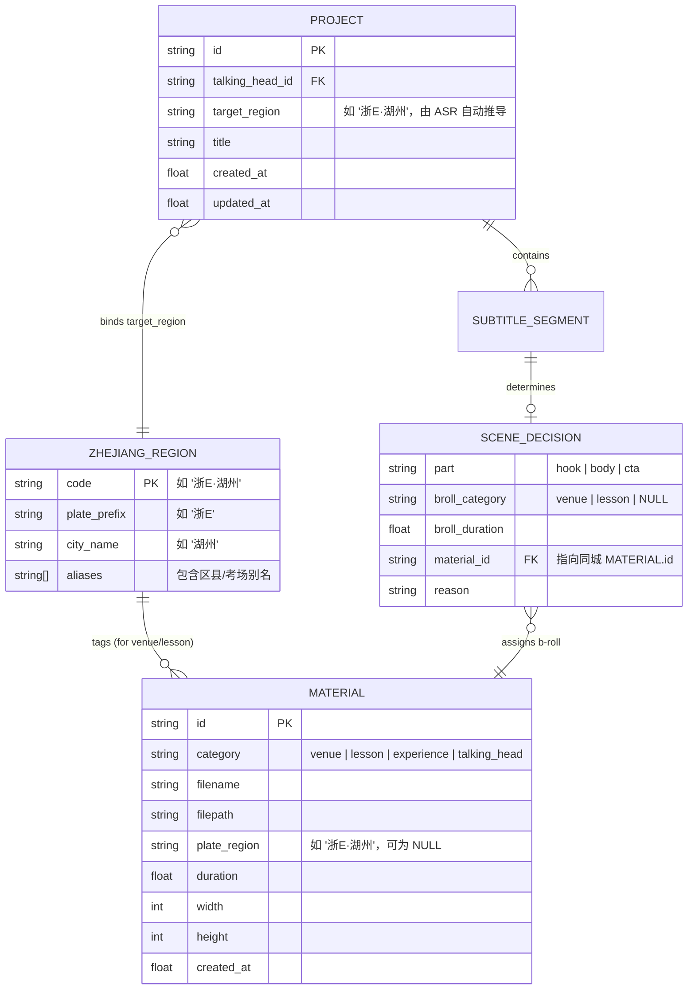

# Data Model: 场地与教学空镜地区车牌标签管理与精准匹配 (014-broll-plate-region)

**Branch**: `014-broll-plate-region`  
**Date**: 2026-09-24  
**Spec Reference**: [specs/014-broll-plate-region/spec.md](file:///d:/project/video_cut/specs/014-broll-plate-region/spec.md)

---

## 1. 实体关系图 (Entity Relationship Diagram)



---

## 2. 核心实体详细结构 (Entities)

### 2.1 浙江地区车牌模型 (ZhejiangRegion)

位于 `backend/app/core/plate_regions.py`：

```python
class ZhejiangRegion:
    code: str              # 统一标准识别码，例如 "浙E·湖州"
    plate_prefix: str      # 车牌前缀，例如 "浙E"
    city_name: str         # 地级市名称，例如 "湖州"
    districts: list[str]   # 下辖区县与著名考场关键词列表
```

**内置 11 地市映射常量表**：
| 车牌代号 | 地级市名 | 标准代码 (`code`) | 核心下辖区县与考场关键词 |
|:---:|:---:|:---:|---|
| **浙A** | 杭州 | `浙A·杭州` | 上城, 拱墅, 西湖, 滨江, 萧山, 余杭, 临平, 钱塘, 富阳, 临安, 桐庐, 淳安, 建德, 场口考场, 三墩 |
| **浙B** | 宁波 | `浙B·宁波` | 海曙, 江北, 镇海, 北仑, 鄞州, 奉化, 象山, 宁海, 余姚, 慈溪 |
| **浙C** | 温州 | `浙C·温州` | 鹿城, 龙湾, 瓯海, 洞头, 瑞安, 乐清, 永嘉, 平阳, 苍南, 文成, 泰顺, 龙港 |
| **浙D** | 绍兴 | `浙D·绍兴` | 越城, 柯桥, 上虞, 诸暨, 嵊州, 新昌, 袍江考场 |
| **浙E** | 湖州 | `浙E·湖州` | 吴兴, 南浔, 德清, 长兴, 安吉, 雉城, 大港考场 |
| **浙F** | 嘉兴 | `浙F·嘉兴` | 南湖, 秀洲, 嘉善, 海盐, 海宁, 平湖, 桐乡 |
| **浙G** | 金华 | `浙G·金华` | 婺城, 金东, 兰溪, 义乌, 东阳, 永康, 武义, 浦江, 磐安, 白龙桥考场 |
| **浙H** | 衢州 | `浙H·衢州` | 柯城, 衢江, 江山, 常山, 开化, 龙游 |
| **浙J** | 台州 | `浙J·台州` | 椒江, 黄岩, 路桥, 临海, 温岭, 玉环, 三门, 天台, 仙居 |
| **浙K** | 丽水 | `浙K·丽水` | 莲都, 龙泉, 青田, 缙云, 遂昌, 松阳, 云和, 庆元, 景宁 |
| **浙L** | 舟山 | `浙L·舟山` | 定海, 普陀, 岱山, 嵊泗 |

---

### 2.2 素材实体扩展 (Material Extension)

在 `backend/app/models/entities.py` 中扩展：

```python
class Material(BaseModel):
    id: str = Field(default_factory=lambda: str(uuid.uuid4()))
    category: MaterialCategory
    filename: str
    filepath: str
    duration: float = 0.0
    width: int = 1080
    height: int = 1920
    fps: float = 30.0
    content_hash: Optional[str] = None
    file_size: Optional[int] = None
    plate_region: Optional[str] = None  # 新增：例如 "浙E·湖州"（仅场地/教学空镜设置）
    created_at: float = Field(default_factory=time.time)
```

**校验与自愈规则**：
- 当 `category in [MaterialCategory.VENUE, MaterialCategory.LESSON]` 时，上传与导入接口强制赋予选中的 `plate_region`；
- 若旧素材 `plate_region is None`，在数据库与接口中保持为 `None`，前端渲染为浅灰色“待标注”轻量角标，不阻断操作。

---

### 2.3 剪辑工程实体扩展 (Project Extension)

在 `backend/app/models/entities.py` 中扩展：

```python
class Project(BaseModel):
    # 基础字段
    id: str = Field(default_factory=lambda: str(uuid.uuid4()))
    talking_head_id: str
    # 业务属性
    target_region: Optional[str] = None  # 新增：例如 "浙E·湖州"，由 ASR 文本自动推导
    title: str = ""
    # ... 其余现有字段保持不变 ...
```

---

## 3. SQLite 数据存储模式变更 (Schema Migration)

权威库 `storage/videocut.db` 结构追加：

```sql
-- 1. materials 表平滑扩展
ALTER TABLE materials ADD COLUMN plate_region TEXT NULL;

-- 2. projects 表平滑扩展
ALTER TABLE projects ADD COLUMN target_region TEXT NULL;

-- 3. 辅助索引加速分镜候选池过滤
CREATE INDEX IF NOT EXISTS idx_materials_cat_region ON materials (category, plate_region);
```

在 `backend/app/db/session.py` 初始化时使用幂等探测（`PRAGMA table_info`）自动执行上述迁移，保障无损升级。
