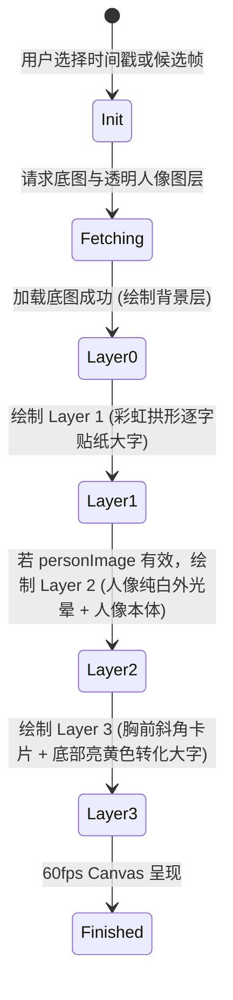

# Data Model: 015-text-behind-person-cover

## 1. 实体与结构定义

### 1.1 CoverTemplateItem 扩展

在封面模板目录中新增 `text_behind_person`：

```typescript
export interface CoverTemplateItem {
  id: string;              // 'text_behind_person'
  name: string;            // '人后拱形字（3D穿插爆款）'
  category: string;        // 'layered_impact'
  badge: string;           // '🔥 顶流穿插'
  sample_preview: string;  // '兔牙教练同款'
  description: string;     // '顶部大字穿插在人像脑后，人物带纯白贴纸发光，彩虹拱形弧度'
  supported_themes: string[]; // ['classic_blue', 'authority_red', 'sunset_orange']
}
```

### 1.2 CoverCandidateFrame 字段扩充

```typescript
export interface CoverCandidateFrame {
  timestamp: number;        // 截帧时间戳（秒）
  thumb_url: string;        // 全幅底图 URL，如 /media/covers/candidates/cand_1.5.jpg
  person_thumb_url?: string;// [新增] 对应帧的透明人像 PNG，如 /media/covers/candidates/cand_1.5_person.png
  score?: number;           // 画面清晰度评分
  has_person?: boolean;     // 是否成功识别并抠出人像
}
```

### 1.3 Canvas 分层渲染状态模型 (Layer Rendering Pipeline)

在前端 `CoverPreviewSelector` 中，分层 Canvas 渲染所使用的数据状态：

```typescript
interface LayeredCoverState {
  baseImage: HTMLImageElement;       // 底层完整视频帧
  personImage?: HTMLImageElement;    // 顶层透明人像图层
  archChars: {
    char: string;
    x: number;
    y: number;
    angle: number;                   // 旋转角度 (弧度)
    fontSize: number;
    coreColor: string;               // 默认 '#FFFFFF'
    strokeColor: string;             // 默认 '#1650CC' (皇家宝蓝)
    outerColor: string;              // 默认 '#FFFFFF'
  }[];
  personWhiteGlow: {
    enabled: boolean;                // 默认 true
    color: string;                   // 默认 '#FFFFFF'
    blur: number;                    // 默认 12px
    strokeWidth: number;             // 默认 14px (高斯/描边)
  };
  hookText: {
    text: string;
    x: number;
    y: number;
    angle: number;                   // 默认 -1.5°
    fontSize: number;                // 默认 ~45px (Canvas缩放比例下)
    coreColor: string;               // 默认 '#FFEE0A' (柠檬亮黄)
    strokeColor: string;             // 默认 '#1650CC' (皇家宝蓝)
  };
  cardBadge?: {
    text: string;
    angle: number;                   // 默认 -8.5°
    bgColor: string;                 // 默认 '#1844AC'
    textColor: string;               // 默认 '#FFFFFF'
  };
}
```

---

## 2. 状态流转与图层合成顺序 (State Transitions)



- 若 `personImage` 暂未就绪或加载失败，系统平滑跳过 Layer 2 的重叠遮挡，直接绘制 Layer 3，绝不阻断界面交互。
