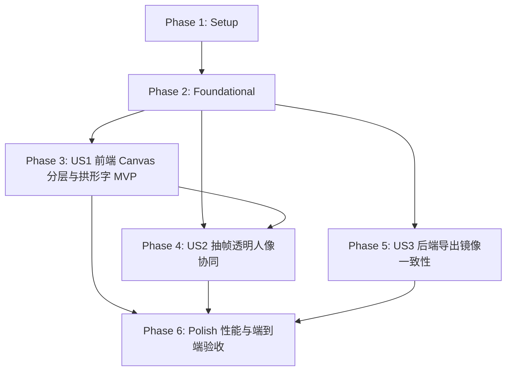

# Tasks: 015-text-behind-person-cover (人后拱形 3D 穿插爆款封面模板与 Canvas 分层渲染体系)

**Input**: Design documents from `specs/015-text-behind-person-cover/` (`spec.md`, `plan.md`, `research.md`, `data-model.md`, `contracts/cover-api.md`, `quickstart.md`)

**Prerequisites**: plan.md (required), spec.md (required for user stories), research.md, data-model.md, contracts/

**Tests**: Tests are requested for backend render alignment and pipeline consistency (pytest in `tests/test_cover_generator.py`).

**Organization**: Tasks are grouped by user story to enable independent implementation and testing of each story.

## Format: `[ID] [P?] [Story] Description`

- **[P]**: Can run in parallel (different files, no dependencies)
- **[Story]**: Which user story this task belongs to (e.g., US1, US2, US3)
- All tasks include exact file paths

---

## Phase 1: Setup (Shared Infrastructure & Vendor Reference)

**Purpose**: 准备技术基线与开源代码（RexanWONG/text-behind-image）参考提取

- [X] T001 验证解压后的开源参考库完整性，确认核心文件规范在 specs/015-text-behind-person-cover/vendor_reference/package/dist/
- [X] T002 [P] 建立前端分层 Canvas 辅助渲染独立工具模块框架在 frontend/src/utils/canvasCoverLayerRenderer.ts
- [X] T003 [P] 建立后端人像轻量分割与透明图层工具桩在 backend/app/core/portrait_segmenter.py

---

## Phase 2: Foundational (Blocking Prerequisites)

**Purpose**: 核心数据模型与 API 契约扩充，作为所有用户故事运行的阻塞前置条件

**⚠️ CRITICAL**: No user story work can begin until this phase is complete

- [X] T004 扩展前端封面候选帧数据结构，增加 person_thumb_url 与 has_person 字段在 frontend/src/services/api.ts
- [X] T005 [P] 扩展前端 CoverTemplateItem 模板目录与默认兜底常量，注册 text_behind_person 在 frontend/src/components/CoverPreviewSelector.tsx
- [X] T006 [P] 扩展后端封面模板配置 COVER_TEMPLATES_CATALOG 与 COVER_PALETTES，注册 text_behind_person 在 backend/app/core/cover_generator.py
- [X] T007 扩展后端 CoverCandidateFrame 实体与响应模型在 backend/app/api/editor.py

**Checkpoint**: 基础模型与数据接口对齐，US1/US2/US3 可以独立基于统一契约开展

---

## Phase 3: User Story 1 - 前端 Canvas 实时渲染“文字在人后”爆款封面 (Priority: P1) 🎯 MVP

**Goal**: 实现前端 60fps 纯 Canvas 四层渲染：Layer 0 底层全图 → Layer 1 彩虹拱形逐字贴纸文字（纯白+宝蓝） → Layer 2 顶层人像贴纸（带 8~14px 纯白发光轮廓遮盖大字） → Layer 3 前景转化层（“避坑课”便签 + 底部“2980全公开”柠檬亮黄转化大字）。

**Independent Test**: 在封面编辑器选择 `text_behind_person` 模板，即使无服务端抠图，也能通过预置透明人像（或降级透明层）在 Canvas 上无卡顿实时呈现“文字穿插在人头后方 + 人像带纯白发光边 + 彩虹拱形独立贴纸”的 3D 视觉效果。

### Implementation for User Story 1

- [X] T008 [P] [US1] 复用 RexanWONG text-behind-image 的 Canvas 三层时序模型与合成参数，在 frontend/src/utils/canvasCoverLayerRenderer.ts 中实现分层编排函数 renderTextBehindPersonCover
- [X] T009 [P] [US1] 实现彩虹拱形自适应排列算法（两端外倾偏转角、正弦高程抛物线、单字呼吸间距与超长自适应）在 frontend/src/utils/canvasCoverLayerRenderer.ts
- [X] T010 [P] [US1] 实现单字独立凹凸贴纸双层描边渲染器（宝蓝内描边 #1650CC + 纯白外描边 #FFFFFF，随笔画凹凸有致）在 frontend/src/utils/canvasCoverLayerRenderer.ts
- [X] T011 [US1] 移植 RexanWONG 的 Canvas 蒙版技术与白光贴纸增强：通过 ctx.shadowColor = '#FFFFFF' 和双重通道混合实现人物置顶与纯白贴纸发光轮廓在 frontend/src/utils/canvasCoverLayerRenderer.ts
- [X] T012 [US1] 实现 Layer 3 前景转化信息层：胸前“避坑课”倾角小胶囊与底部柠檬亮黄（#FFEE0A）转化大字在 frontend/src/utils/canvasCoverLayerRenderer.ts
- [X] T013 [US1] 在 frontend/src/components/CoverPreviewSelector.tsx 的 drawCanvasPreview 中接入 renderTextBehindPersonCover 分支
- [X] T014 [US1] 添加人像透明图层加载失败或空镜帧的平滑降级保护（自动降级为无遮挡彩虹拱形大字，绝不白屏崩溃）在 frontend/src/components/CoverPreviewSelector.tsx

**Checkpoint**: User Story 1 可脱离后端直接在前端实时预览 1:1 爆款封面效果，拖拽文案实时刷新达到 60fps。

---

## Phase 4: User Story 2 - 视频截帧与人物图层自动轻量协同 (Priority: P2)

**Goal**: 用户选择候选帧或时间轴截帧时，后端轻量生成底图与对应透明人像图层（Foreground Cutout），前端自动异步获取并注入 Canvas 渲染通道，彻底免去手动抠图。

**Independent Test**: 调用 `/projects/{id}/cover-frame` 截帧接口，能同时生成 `.jpg` 原始帧与对应 `_person.png` 透明人像图层，前端选帧后秒级加载展示。

### Implementation for User Story 2

- [X] T015 [P] [US2] 在 backend/app/core/portrait_segmenter.py 中基于 OpenCV GrabCut / 肤色连通域实现离线轻量单帧人像切分与羽化掩模生成算法
- [X] T016 [US2] 在 backend/app/api/editor.py 中修改 cover_candidates 接口，支持检测并生成每张候选帧的 person_thumb_url
- [X] T017 [US2] 在 backend/app/api/editor.py 中修改 /projects/{id}/cover-frame 接口，支持 extract_person=true 并返回 person_path 与 person_thumb_url
- [X] T018 [US2] 在 frontend/src/components/CoverPreviewSelector.tsx 中添加所选候选帧的 personImage 异步预加载与状态缓存机制

**Checkpoint**: 截帧与候选帧切换时，透明人像自动异步供给，前端 Canvas 自然完成 3D 穿插覆盖。

---

## Phase 5: User Story 3 - 导出与成片第一帧嵌入 1:1 像素级一致 (Priority: P3)

**Goal**: 导出 1080×1920 封面大图与成片第一帧压制时，后端 `cover_generator.py` 与前端 Canvas 渲染具有严格一致的字号比例、拱形曲率、描边厚度和图层关系。

**Independent Test**: 运行 pytest 自动化测试，验证 Pillow 渲染的 `text_behind_person` 产物包含正确的分层与文字参数，并输出校验图。

### Tests for User Story 3

- [X] T019 [P] [US3] 编写 test_text_behind_person_render 自动化测试用例在 tests/test_cover_generator.py

### Implementation for User Story 3

- [X] T020 [US3] 在 backend/app/core/cover_generator.py 中实现 render_text_behind_person_cover 渲染分支（背景铺底 → Pillow 拱形贴纸字 → 人像贴纸带白边叠加 → 底部亮黄大字与胸前便签）
- [X] T021 [US3] 在 backend/app/core/cover_generator.py 的 render_cover_image 入口中分发 text_behind_person 模板处理
- [X] T022 [US3] 对齐前端 Canvas 坐标系与后端 1080×1920 坐标系参数缩放比（360:1080 = 1:3），确保两端像素级视觉镜像一致

**Checkpoint**: 导出的 1080×1920 封面与前端所见即所得，自动化测试 100% 绿灯。

---

## Phase 6: Polish & Cross-Cutting Concerns

**Purpose**: 性能调优、边界异常保护与端到端验收

- [X] T023 [P] 优化多字与生僻字在 Canvas 拱形排版下的字符居中度与包围盒计算在 frontend/src/utils/canvasCoverLayerRenderer.ts
- [X] T024 验证并调优弱光背景、强逆光背景下人像纯白贴纸发光外轮廓的对比度在 frontend/src/utils/canvasCoverLayerRenderer.ts 与 backend/app/core/cover_generator.py
- [X] T025 执行 quickstart.md 描述的端到端验证流程（前端实时交互与后端高清导出镜像比对）并在 specs/015-text-behind-person-cover/quickstart.md 中补充实测记录

---

## Dependencies & Execution Order

### Phase Dependencies

- **Setup (Phase 1)**: 无外部依赖，可立即开始。
- **Foundational (Phase 2)**: 依赖 Phase 1，作为全故事的前置契约（BLOCKS 所有用户故事）。
- **User Story 1 (Phase 3, P1 🎯 MVP)**: 依赖 Phase 2，可独立实现纯前端 Canvas 分层渲染与视觉复刻。
- **User Story 2 (Phase 4, P2)**: 依赖 Phase 2 与 Phase 3，打通后端抽帧透明人像自动供给。
- **User Story 3 (Phase 5, P3)**: 依赖 Phase 2，可与 Phase 3/4 并行或顺序执行，保证后端导出 1080×1920 镜像对齐。
- **Polish (Phase 6)**: 依赖 US1、US2、US3 完成后统一收敛。

### User Story Dependencies

---

## Parallel Execution Opportunities

- **Phase 1**: T002（前端工具模块）与 T003（后端分割模块框架）完全独立，可并行开展。
- **Phase 2**: T005（前端模板注册）与 T006（后端模板注册）可并行开展。
- **Phase 3 (US1)**: T008（三层时序框架）、T009（彩虹拱形算法）、T010（双层贴纸描边）可拆分模块并行编写。
- **Phase 5 (US3)**: T019（单测编写）可优先于 T020/T021 编写并驱动实现。

---

## Implementation Strategy

### MVP First (User Story 1 Only)

1. 完成 Phase 1（Setup）与 Phase 2（Foundational）。
2. 完成 Phase 3（User Story 1 前端 Canvas 渲染）。
3. **验证检查点**：在浏览器中直接预览“文字在人后 + 彩虹拱形 + 人物发光贴纸 + 柠檬黄大字”效果，确认达到参考爆款品质（MVP 即告可用！）。

### Incremental Delivery

1. **增量 1 (MVP)**: 前端 Canvas 即时分层渲染可用，支持选用现有底图与抠图素材。
2. **增量 2 (自动化体验)**: 接入后端轻量单帧人像切分，用户截帧自动获得透明人像图层。
3. **增量 3 (高清导出)**: 后端 `cover_generator.py` 同步输出 1080×1920 高清大图，全流程自动化闭环。
