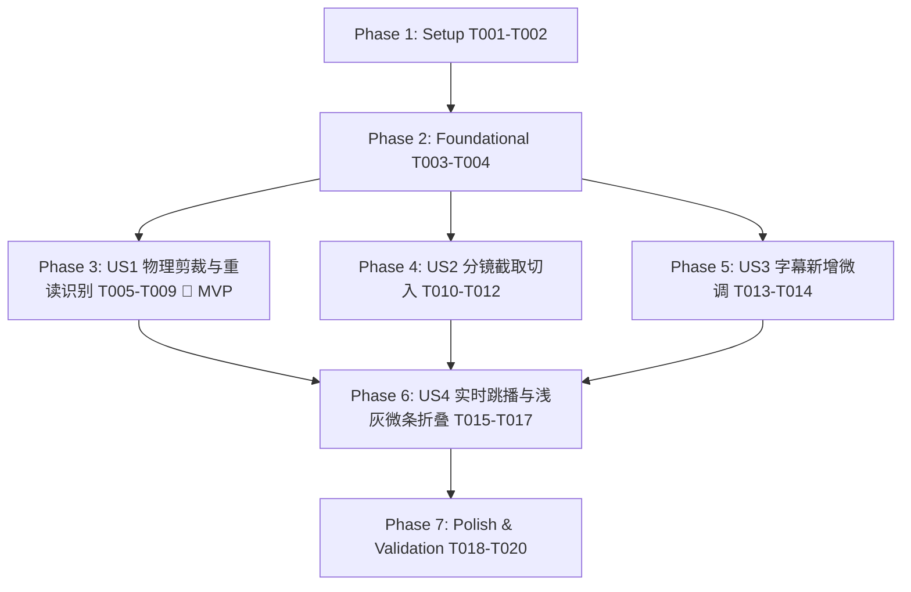

# Tasks: 自主分镜切入裁剪与字幕重叠定位原口播视频误读裁剪 (Storyboard Trim & Subtitle Retake Pruning)

**Input**: Design documents from `/specs/016-storyboard-trim-sub-retake-prune/`
**Prerequisites**: plan.md (required), spec.md (required for user stories), research.md, data-model.md, contracts/

## Format: `[ID] [P?] [Story] Description`

- **[P]**: Can run in parallel (different files, no dependencies)
- **[Story]**: Which user story this task belongs to (e.g., US1, US2, US3, US4)
- Include exact file paths in descriptions

---

## Phase 1: Setup (Shared Infrastructure)

**Purpose**: 清理环境，建立测试基线

- [x] T001 校验 Python 测试套件与环境编码（运行 `.\.venv\Scripts\pytest.exe tests/` 并注入 `$env:PYTHONUTF8='1'; $env:PYTHONIOENCODING='utf-8'`）
- [x] T002 [P] 清理先前概念验证的临时文件（移除 `frontend/src/pages/FeaturePrototypeDemo.tsx` 及 `frontend/src/App.tsx` 中的临时挂载）

---

## Phase 2: Foundational (Blocking Prerequisites)

**Purpose**: 核心数据模型与 Schema 扩展，阻塞所有上层故事

- [x] T003 [P] 在 `backend/app/models/project.py` 与 `backend/app/schemas/project.py` 中为 `BrollReplacement` 新增 `source_start_time: float = 0.0` 字段
- [x] T004 [P] 在 `backend/app/api/editor.py` 中更新字幕与分镜保存接口，规范 `prune_spans` 与 `brolls` 的数据接收与 SQLite 持久化

**Checkpoint**: 基础数据模型就绪，可开始推进各 User Story

---

## Phase 3: User Story 1 - 口播误读重叠定位与原视频物理裁剪 (Priority: P1) 🎯 MVP

**Goal**: 实现 ASR 重读阻断、前缀重叠（$\ge 75\%$）高精度识别、三重防误剪安全网，以及原视频音画物理裁剪拼接（15ms 平滑交叉淡化防爆音）

**Independent Test**: 上传包含重读口误的视频，算法精准识别并标记；点击剔除后，导出的成片物理文件时长准确减少，断点处音画连贯无爆音

### Tests for User Story 1
- [x] T005 [P] [US1] 编写 ASR 短句重读阻断单元测试 `tests/test_asr_retake_guard.py`
- [x] T006 [P] [US1] 编写前缀重叠比对与防误剪测试 `tests/test_prune_retake_prefix.py`

### Implementation for User Story 1
- [x] T007 [US1] 在 `backend/app/native_engine/asr_runner.py` 的 `merge_short_segments` 中增加重读阻断守卫（相邻短句前缀重合时严禁合并）
- [x] T008 [US1] 在 `backend/app/native_engine/prune_engine.py` 的 `find_repeated_takes` 中实现前缀重叠比对算法（$\ge 75\%$）与排比句（gap < 0.2s）及独立长句防误剪保护
- [x] T009 [US1] 在 `backend/app/native_engine/ffmpeg_filter.py` 中强化基于 `kept_spans` 的原视频音画物理剪切（`[0:v]trim` + `[0:a]atrim` + `concat` + 15ms `afade` 防爆音）并通过 `tests/test_prune_video_export.py` 验证

**Checkpoint**: User Story 1 具备独立端到端可用性（真正物理裁剪原视频，绝不只删字幕）

---

## Phase 4: User Story 2 - 自主分镜切入时间与素材区间裁剪插入 (Priority: P2)

**Goal**: 支持用户自主指定分镜在主视频中的切入时间区间，以及分镜素材自身的截取 In 点 (`source_start_time`)，分镜强制静音作为纯画面覆盖

**Independent Test**: 用户设置素材从 1.8s 截取并切入主视频 2.5s~5.6s，导出视频在该区间准确呈现素材截取画面，原口播音频平滑作为旁白播放

### Tests for User Story 2
- [x] T010 [P] [US2] 编写分镜素材 In 点截取测试 `tests/test_broll_source_trim.py`

### Implementation for User Story 2
- [x] T011 [US2] 在 `backend/app/native_engine/ffmpeg_filter.py` 中更新分镜合成滤镜：支持 `trim=start={source_start_time}:duration={dur}`，且强制剥离分镜音频
- [x] T012 [US2] 在 `frontend/src/components/SubtitleList.tsx` 卡片内就地实现分镜设置：支持选择素材、截取区间 $[s_0, s_1]$ 与切入时间 $[t_0, t_1]$ 调整

**Checkpoint**: User Story 1 与 User Story 2 均可独立运行并无缝协同

---

## Phase 5: User Story 3 - 任意时间段字幕新增与时间范围自主调整 (Priority: P3)

**Goal**: 支持创作者在任意时间区间新增字幕并毫秒级微调既有字幕时间戳，严格防倒置与高亮词全生命周期无损

**Independent Test**: 用户在两句间插入一条字幕，播放器准时呈现，且字幕高亮词自动提取并持久化

### Implementation for User Story 3
- [x] T013 [P] [US3] 在 `frontend/src/components/SubtitleList.tsx` 中增加就地“插入字幕”交互与起止时间微调输入，内置 `end > start` 防倒置校验
- [x] T014 [US3] 在 `backend/app/api/editor.py` 中确保新增字幕自动触发高亮词提取规则，维持全局高亮词无损

**Checkpoint**: 字幕时间轴具备毫秒级任意增删改自由度

---

## Phase 6: User Story 4 - 实时所见即所得 (Live WYSIWYG) 预览与浅灰微条折叠恢复 (Priority: P4)

**Goal**: 播放器实现虚拟跳播（Virtual Jump-Cut）与分镜实时贴片；卡片以极简浅灰微条就地折叠并支持一键恢复，无任何弹窗通知噪音

**Independent Test**: 用户点击卡片剔除，播放器立即跳播该区间，卡片折叠为浅灰条；点击“恢复”，音画与字幕立即无缝还原

### Implementation for User Story 4
- [x] T015 [P] [US4] 在 `frontend/src/components/VideoPlayer.tsx` 中实现虚拟跳播逻辑（监听播放时间，进入 `prune_spans` 时立即向前 jump 到 end_time）
- [x] T016 [P] [US4] 在 `frontend/src/components/VideoPlayer.tsx` 中实现分镜实时贴片叠加（Live B-roll Overlay），根据时间轴同步播放静音分镜画面
- [x] T017 [US4] 在 `frontend/src/components/SubtitleList.tsx` 中实现被裁口误卡片浅灰微条折叠与“恢复”按钮，点击即时还原音画与时间轴

---

## Phase 7: Polish & Cross-Cutting Concerns

**Purpose**: 全链路测试验证、代码清理与打包检查

- [x] T018 运行全量后端测试套件：`tests/test_asr_retake_guard.py`、`tests/test_prune_retake_prefix.py`、`tests/test_broll_source_trim.py`、`tests/test_prune_video_export.py` 与高亮词全生命周期测试
- [x] T019 运行前端 TypeScript 检查与打包：`pnpm build` 确认 0 错误
- [x] T020 按照 `specs/016-storyboard-trim-sub-retake-prune/quickstart.md` 完成全流程端到端回归验证

---

## Dependencies & Execution Order

## Implementation Strategy

1. **MVP 优先 (User Story 1)**：先跑通 ASR 重读阻断守卫 + 前缀重叠算法 + FFmpeg 物理音视频切片拼接（防爆音），确立底层硬核能力。
2. **渐进交付**：依序推进分镜 In 点截取（US2）、字幕增删改（US3）与播放器实时所见即所得交互（US4）。
3. **零容忍防线**：坚决禁止假剪辑与只删字幕文字；全程保证高亮词不丢失；界面彻底去除冗余横幅通知。
